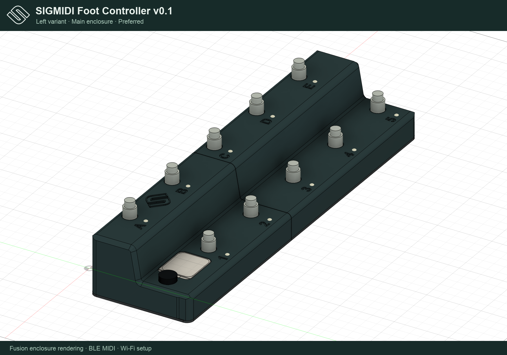

# SIGMIDI Foot Controller v0.1

A programmable stompbox-style BLE MIDI foot controller using the DFRobot DFR1075 (FireBeetle 2 ESP32-C6) and Waveshare 24382 LCD, with MIDI sent to an iPad.

The BLE device is named **SIGMIDI Foot Controller v0.1**; Wi-Fi setup uses **SIGMIDI-xxxx**. Configuration backups download as `sigmidi-foot-controller.json`.

## Confirmed requirements

- Edit the complete controller configuration through a Wi-Fi browser interface, including on an iPad.

- One incremental rotary encoder with 20 detents per revolution and a momentary push switch for menu navigation and setup.
- Six to ten momentary (monostable) footswitches, configurable in software (default ten), operated one at a time. Simultaneous footswitch presses are not a requirement.
- Each switch independently stores an ordered sequence of MIDI messages for press and an optional separate sequence for release.
- Support Control Change (CC) and Program Change (PC), with an independent MIDI channel for every message.
- Transmit MIDI over Bluetooth Low Energy MIDI to an iPad.
- Optional Pololu 2535 (5 mm diffused, integrated WS2811) RGB indicators: one LED per switch, initially assigned 1:1, with white for performed press actions and yellow for performed release actions.
- Two continuous pedal inputs, each supporting either a two-wire variable resistor or a three-wire potentiometer, selectable independently.
- Support pedal resistances from 0 to 10 kΩ, a configurable maximum resistance, and linear or logarithmic response per input.

## Proposed design

Use the ESP32-C6 internal ADC for a single modular 4/6/8/10-switch resistor ladder and both continuous pedals. Only one footswitch needs to be detected at a time. The Waveshare 24382 is a 280×240 ST7789V2 color LCD (landscape) connected over SPI; it has no touch input. No external ADC or GPIO expander is required. Enable Wi-Fi Setup from the encoder menu to start a password-protected access point and open the onboard editor from an iPad browser; no internet connection is needed.

Choose the count in the Wi-Fi editor under **Settings → Number of footswitches**, or the LCD under **EDIT CONFIG → Switch count**. See [modular ladder wiring, numbering and resistor values](docs/resistor-ladders.md), including individual wiring drawings and voltage targets. Select **Modular** wiring for a four-switch base plus right extensions in the preferred Left enclosure. Upper switches are labeled A–E from left to right; lower switches are 1–5 from left to right. Existing labels remain stable as sections are added. Actions, calibration and LED assignments stay attached to physical switches. Existing configurations migrate in legacy linear wiring mode without remapping.

**Left is the default for new configurations.** Choose **Settings → Enclosure variant → Left · Screen on left** in the Wi-Fi editor, or **EDIT CONFIG → ENCLOSURE → LEFT** on the LCD, then Save. Left selects mirrored switch/calibration list order and 180° display rotation together; Right uses the original order and 0°. Names, MIDI messages, calibration and LED assignments stay with the same physical switches. The variant persists across restarts; older 180° settings migrate to Left, and older saved configurations without a direction setting retain Right.

The alternate supply is **9 V DC, center-negative**, through a 5.5 × 2.1 mm socket and Pololu S13V10F5 #4083 (Kamami 1178565). See [power wiring, ratings and chassis placement](docs/power.md).

See [hardware](docs/hardware.md) for the proposed electrical design and [firmware](docs/firmware.md) for configuration, scheduling, calibration, and acceptance criteria.

## Project status

Initial ESP-IDF 5.3.1 firmware is implemented and compiles for ESP32-C6. It includes BLE MIDI, the ST7789V2 LCD, encoder setup menus, ladder/pedal input processing, NVS configuration storage, an optional hardware-timed WS2811 chain, and a Wi-Fi browser editor. Host tests cover the MIDI engine and configuration validation. Hardware operation and iPad compatibility have not yet been tested.

See [build, flash, and first-run instructions](docs/bringup.md). [Optional LED wiring and setup](docs/leds.md) covers GPIO16, the level shifter, power, assignments and timing. The larger display uses a new graphical performance view, seven-row scrolling menus with aligned parameter values, purple action labels, color-coded PC/CC entries and a Wi-Fi setup card. [Menu previews](previews/display-preview.png) are rendered from the actual firmware UI. [Updated chassis and display mounts](design/fusion/README.md) include the manufacturer STEP model and revised screen opening.

## Install firmware from the browser

Use the preserved [release bundles](distribution/README.md). Run `python3 scripts/serve_flasher.py` and open **http://localhost:8766/** in desktop Chrome or Edge. Connect the DFR1075 over USB-C and choose **Connect & install**. Leave **Erase device** unchecked to preserve compatible settings.

The versioned application is **`distribution/sigmidi-foot-controller-0.1.bin`**. The build also creates **`distribution/sigmidi-foot-controller-0.1-web-flasher.zip`**, a portable installer with firmware and local browser dependencies. See [web flasher instructions](docs/web-flasher.md) and [preview](previews/web-flasher.png). Physical USB flashing remains to be verified on the controller.

## Implementation order

1. Verify the board revision and proposed pin assignments; bring up the ST7789V2 display and calibrate the internal ADC.
2. Bring up BLE MIDI and verify CC/PC delivery to the intended iPad application.
3. Add the resistor ladder, debounce, independent press/release sequences, and ordered scheduling.
4. Prototype both pedal interface modes, then add calibration, response curves, and CC filtering.
5. Add configuration editing using rotary encoder navigation and a locally hosted Wi-Fi browser editor, persistent configuration, and fault/status feedback.
6. Validate single-switch operation alongside both pedals, reconnection, power cycling, and enclosure wiring.

## Details to resolve during hardware design

- Confirm the proposed wiring against the actual board revision.
- Pedal jack pinout and polarity for the pedals to be used; TRS expression-pedal wiring is not universal.
- Validate the selected 1 A converter against the complete controller and optional LED load.
- Intended iPad MIDI application and its displayed PC numbering convention.

## Current project files

Firmware and tests are in `src/`, `tests/` and `web/`; electrical instructions are in `docs/`. [Current CAD and print packages](design/fusion/README.md) use straight base glue lips and one universal pair base for all modular positions. [The preview gallery](previews/README.md) contains current native CAD renders, real firmware LCD screens and screenshots of the Wi-Fi editor. Superseded snapshots and build intermediates have been removed; current source, datasheets, renders and manufacturing files are retained.

The [preferred Left enclosure variants](design/fusion/mirrored/README.md) put the electronics on the left and modular extensions on the right. Original CAD and print deliveries remain available unchanged.

## Enclosure renderings

[Left modular](previews/sigmidi-left-modular.png) · [Left CAD and print packages](design/fusion/mirrored/README.md) · [Right alternative](previews/sigmidi-right-main.png) · [Right modular](previews/sigmidi-right-modular.png)

The [complete latest Fusion model](design/fusion/sigmidi-foot-controller-0.1.f3d) preserves the native component hierarchy for all Left and Right main/modular assemblies, including the embossed icon. [Export details](design/fusion/sigmidi-foot-controller-0.1-model.json). Firmware and installer releases live in [distribution/](distribution/README.md); `build/` is disposable.
