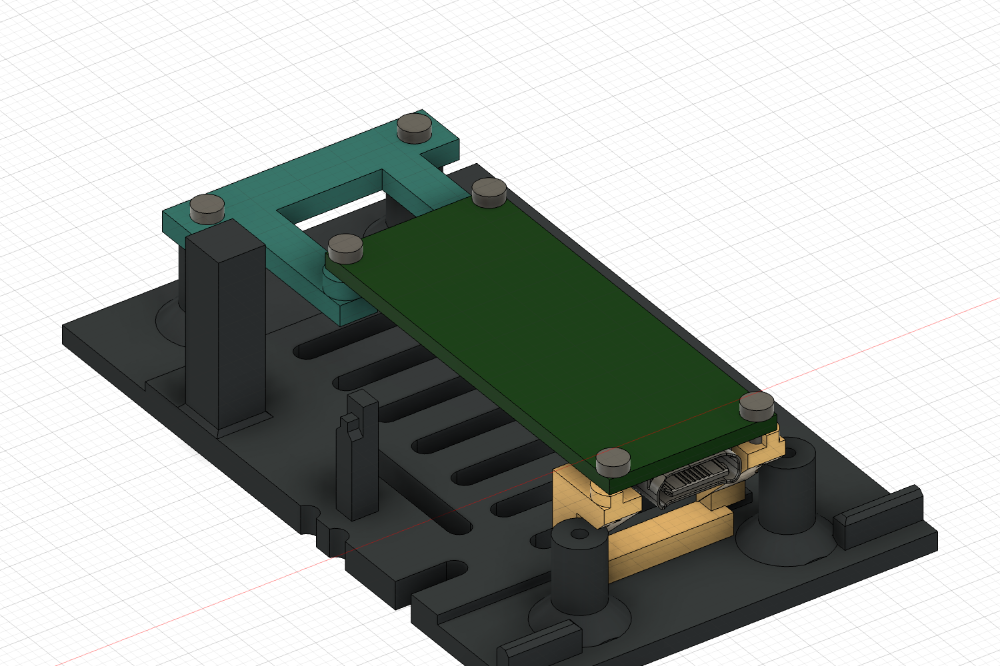
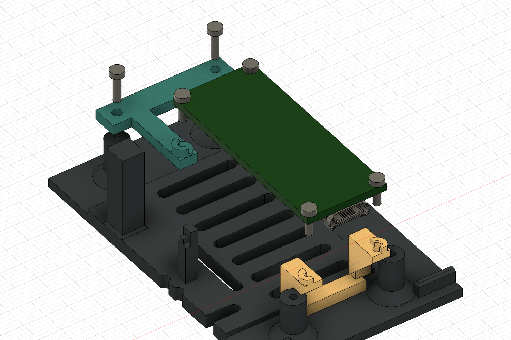
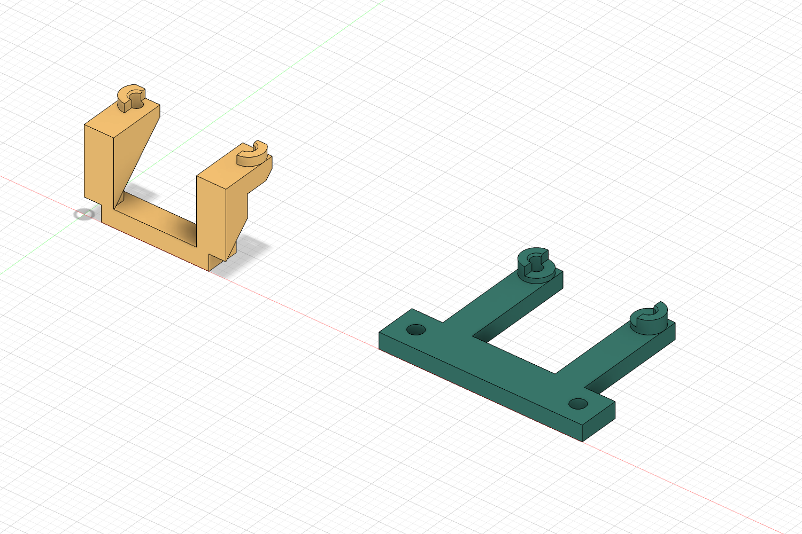

# SIGMIDI v0.1 — Arduino Nano ESP32 mounting kit

Two removable board adapters fit the **Arduino Nano ESP32 ABX00083 without headers** to the existing enclosure floor. The bottom shell, original mounting poles, upper shell, USB pocket and external shape are unchanged. The complete native Fusion model includes the kit in the Left and Right main and modular assemblies, with the former MCU references hidden.

## Parts and fasteners

| Part | Attachment | Nano attachment |
|---|---|---|
| [USB-side glue insert](usb-side-glue-insert.stl) — amber | Glue its flat foot to the unvented base immediately inside the rear USB pocket | Two M1.6 × 5 mm pan-head screws |
| [Opposite-end bridge](existing-pole-insert.stl) — teal | Two M1.6 × 6 mm pan-head screws into the existing far-end MCU poles | Two M1.6 × 5 mm pan-head screws |

Print one of each. The Nano is **component-side down**, with USB-C facing the existing rear opening. Its bare reverse face and screw heads face upwards. The board is 43.18 × 17.78 mm; the mounting-hole centres form a 40.64 × 15.24 mm rectangle with Ø1.66 mm holes. Supports are relieved around components beside the corner holes and bear on the outward PCB edges. No pin headers are included in the clearance model; solder peripheral wires directly to the board pads.

PCB pilots are Ø1.55 mm and 3.6 mm deep. A 5 mm screw passes through the approximately 1.61 mm PCB and enters the pilot by approximately 3.39 mm. The bridge has Ø2.0 mm clearance holes and a 2.2 mm plate, leaving approximately 3.8 mm engagement for its 6 mm screws in the existing 6 mm-deep pilots. Screw models show nominal shanks, not helical threads. Tighten gently and test the printed pilots first.

The USB-side foot has a 14.6 × 3.3 mm glue land and a nominal 0.15 mm adhesive allowance. Its sloping arms print at 45°. The original unused USB-side poles remain intact; reliefs in the insert clear them. The USB face is 0.3 mm farther inside the enclosure than the former board's face. Confirm cable-plug access before bonding.

## Printing and assembly

Use PETG, **0.6 mm nozzle and 0.3 mm layers**. Both supplied [3MFs](usb-side-glue-insert.3mf) ([bridge](existing-pole-insert.3mf)) place the flat foot or bridge plate on the bed, pilots upward. **No supports are needed in the checked Prusa MK3S+ toolpaths.** Estimated print times are 4m43s and 4m45s; total filament is about 2 g. The same insert geometry fits both enclosure handednesses; it is translated, not reflected.

1. Remove the former MCU and its four screws. Leave all original enclosure poles in place.
2. Dry-fit the Nano and both inserts. Use the board to align the four supports, and loosely attach the bridge to the two far-end poles.
3. Seat the USB connector in its existing pocket. Confirm cable seating, screw access, component clearance and the base-to-upper-shell fit with the actual board.
4. Prepare the PETG bonding surfaces and use an adhesive suitable for PETG. Apply adhesive only beneath the amber insert's flat foot; protect the PCB and screw pilots. Use the dry-fitted board/bridge to hold alignment while the adhesive cures.
5. Secure the board with the four M1.6 × 5 screws and the bridge with two M1.6 × 6 screws. Do not glue the PCB or bridge to the base. Leave strain-relief slack in all wiring.

The close-up renders show a **cropped portion of the existing base**, not a replacement floor to print.

## CAD and checks

- [Latest complete Fusion model](../sigmidi-foot-controller-0.1.f3d): all four native assemblies, modular libraries and fitted kits.
- [Native kit](nano-esp32-mount-kit.f3d) and [STEP kit](nano-esp32-mount-kit.step): board, adapters and screw references. Print only the two designated STLs/3MFs.
- [Assembly clearance report](assembly-clearance.json): no volumetric collisions against the existing shell, base and hardware in any of the four assemblies, including the board and four board-screw envelopes. Fastener engagement with pilots is intentional.
- [Mount fit](mount-fit.json) and [installation](installation.json): dimensions, positions and confirmation that original enclosure-body revisions were unchanged.
- [Print verification](print-verification.json): both meshes are closed, single-part solids and slice without support extrusion.
- `build_mounts.py`, `install_mounts.py`, `verify_mounts.py`, `render_mounts.py`: source scripts for the Fusion MCP. `check_prints.py`: mesh/slicer checks.

These are nominal CAD and slicing checks. Printed pilot fit, adhesive strength, connector seating, vibration and thermal performance require a physical build. A minimum-distance measurement was not available for the imported USB reference faces; the collision checks completed for all four variants.

## Electrical compatibility

This kit is a **mechanical conversion**. The current distribution firmware and existing DFR1075 wiring diagrams target ESP32-C6 and must not be used unchanged with the ESP32-S3-based Nano ESP32. GPIO remapping, ADC setup and native USB MIDI firmware are separate from the mount geometry.

The Nano's recommended **VIN is 6–21 V**, so the existing regulated 5 V controller connection cannot simply be transferred to VIN. With the enclosure's 9 V centre-negative supply, feed the Nano VIN from the **positive barrel sleeve (+9 V)** and GND from the negative centre, with the intended input protection. Keep the Pololu 5 V output for the optional LED supply and share ground. Do not connect the Pololu output directly to USB VBUS; the Nano VBUS pin is tied to USB power and is not a 5 V output when powered from VIN. USB-only operation does not power the separate converter/LED rail. Final power routing must be checked alongside the Nano wiring and USB implementation.

## Manufacturer sources

[Arduino Nano ESP32 documentation](https://docs.arduino.cc/hardware/nano-esp32/) · [Official datasheet](https://docs.arduino.cc/resources/datasheets/ABX00083-datasheet.pdf) · [Official STEP archive](https://docs.arduino.cc/resources/models/ABX00083-step.zip).

Local copies are in `datasheets/`. PCB dimensions and bores follow page 17 of the datasheet; the manufacturer's STEP provides the component envelopes. The plain PCB reference in the STEP has been given the four drawing-specified mounting bores, and header models are excluded.
