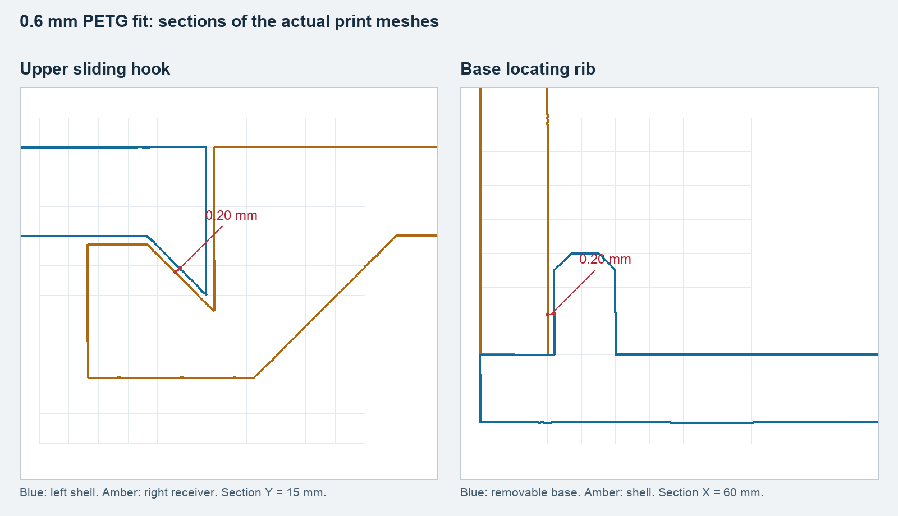
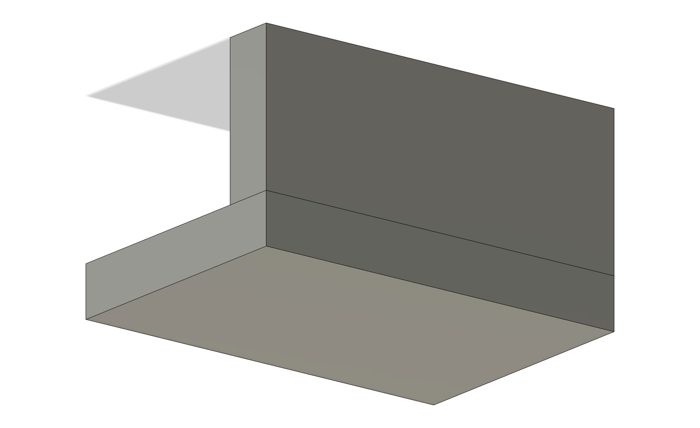
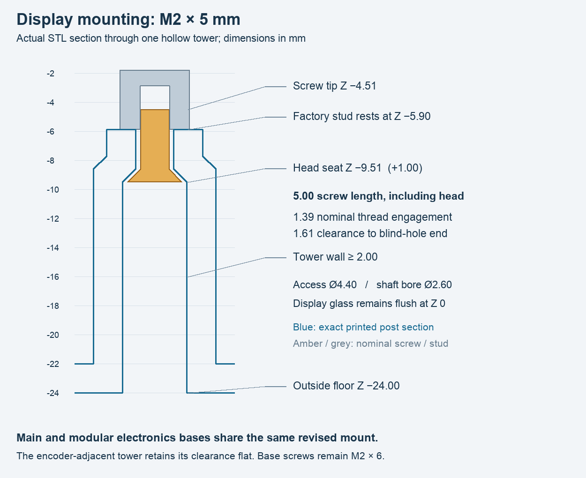
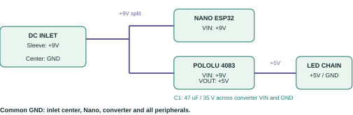
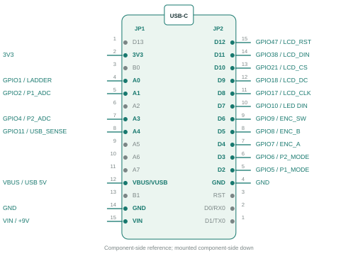
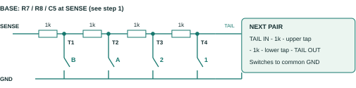
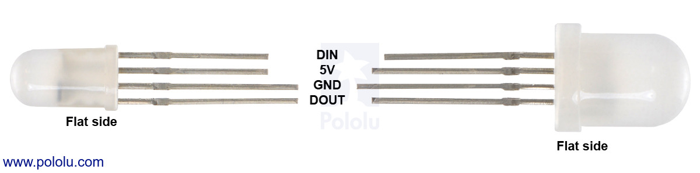
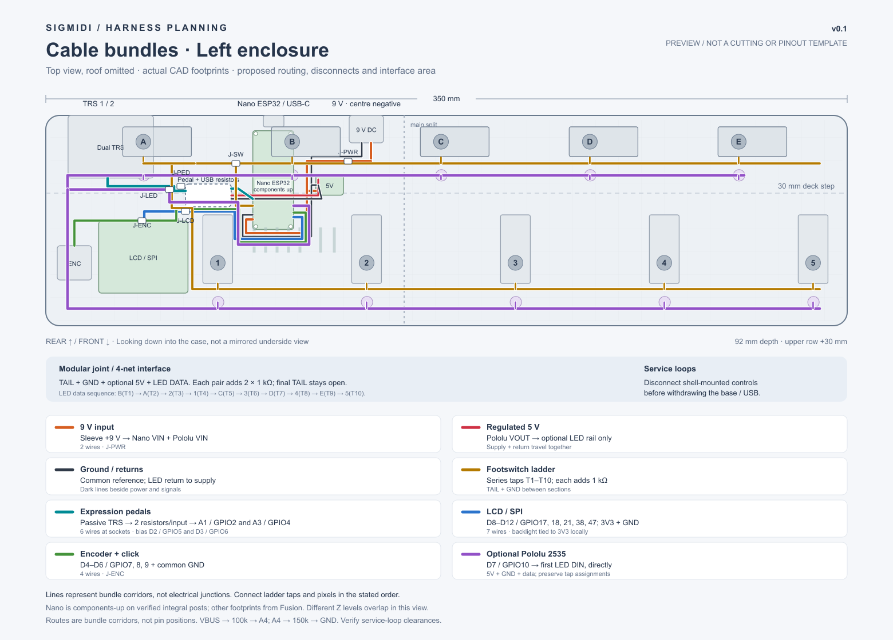

# SIGMIDI Foot Controller

## Assembly guide - Version 0.1

Build the Arduino Nano ESP32 controller, from printed parts to a tested USB/BLE MIDI instrument. **Left** is the preferred enclosure: display and encoder on the left, extensions on the right. Instructions cover the fixed ten-switch Main enclosure and Modular 4/6/8/10-switch assemblies. Right-specific differences are called out where needed.

| Build stage | Pages |
|---|---|
| Select parts, print and join the enclosure | 2-3 |
| Install controls, display and Nano directly on the base | 4-5 |
| Wire power, Nano, LCD and encoder | 6-8 |
| Wire switches, pedals and optional LEDs | 9-11 |
| Inspect, power up, flash and calibrate | 12-14 |
| Close the enclosure and run acceptance checks | 15 |

## Before you start

Use the [bill of materials](bill-of-materials.md) for purchased quantities and the [unified electrical schematic](../output/pdf/sigmidi-electrical-single-page.pdf) for a full-size wiring reference. Tools: PETG printer, small screwdrivers and nut drivers, soldering iron, cutters/strippers, multimeter, heat-shrink, a USB data cable and PETG-compatible adhesive. Work on an unpowered assembly when soldering, fitting parts or checking resistance.

This is an assembly procedure for the current CAD and wiring design, not a completed bench qualification. Confirm printed fit, actual connector/fastener dimensions, electrical operation and temperature on your build. The [user manual](user-manual.md) covers performance and all editing menus.

<!-- page -->

# 1. Select the parts

## Choose a matching set

For **Left Main 10**, print one each of `shell-left`, `shell-right`, `base-left`, `base-right` from [mirrored/main](../design/fusion/mirrored/main/). For **Right Main 10**, use the same filenames from [fusion/print](../design/fusion/print/). Do not mix handednesses. Main body size is 350 x 92 x 54 mm, excluding controls and the raised icon.

For **Left Modular**, use [mirrored/modular](../design/fusion/mirrored/modular/). Every size needs one `electronics-shell-left`, one `electronics-base-left` and one `right-cap`, plus the following. Filenames below omit `.stl` / `.3mf`.

| Switches | Repeatable uppers | Cap-adjacent upper | pair-base qty |
|---|---|---|---|
| 4 | None | None | 0 |
| 6 | None | pair-shell-at-right-cap-C | 1 |
| 8 | pair-shell-C | pair-shell-at-right-cap-D | 2 |
| 10 | pair-shell-C and pair-shell-D | pair-shell-at-right-cap-E | 3 |

**Right Modular:** use [fusion/modular](../design/fusion/modular/), with `electronics-shell`, `electronics-base`, `left-cap` and the same base quantity. For 6 switches use `pair-shell-at-cap-C`; for 8 use `pair-shell` plus `pair-shell-at-cap`; for 10 use `pair-shell`, `pair-shell-D` plus `pair-shell-at-cap-E`. The cap-adjacent upper is different from a repeatable upper. Modular widths are 164.85 / 229.85 / 294.85 / 359.85 mm for 4 / 6 / 8 / 10 switches.

## Direct Nano mounting and fasteners

The electronics base includes four reinforced Nano mounting posts. Print enclosure parts, not electronic reference bodies from the complete CAD assembly. [Direct mount details](../design/fusion/nano-esp32/README.md).

| Fastener | Quantity | Use |
|---|---|---|
| M2x6 countersunk | Main: 8; Modular: 4 + 2 per pair | Removable base to upper shell |
| M2x5 countersunk | 4 | LCD hollow mounts into factory blind studs |
| M1.6x5 pan head | 4 | Nano PCB directly to integral base posts |

Total printed pieces: Main 4; Modular 4/6/8/10 uses 3/5/7/9. Nano posts are integral to the electronics base. Collect supplied switch nuts/washers, encoder hardware/knob, dual-TRS nuts/washers and the DC inlet nut if fitted. Verify actual screw engagement gently before installing electronics.

**Pass check:** one enclosure variant, one count, correct labeled uppers and a matching cap; all screws sorted by length.

<!-- page -->

# 2. Print, clean and join

## Print and clean the empty parts

1. Print fit coupons first. Use the supplied Prusa MK3S+ PETG profile: **0.6 mm nozzle, 0.3 mm layers, 6 mm brim**. Let parts cool before assessing fit. Keep global XY compensation at zero; check first-layer bulges and the profile's 0.2 mm elephant-foot compensation before altering dimensions.
2. Main uppers print outer-end down, split up. Left pair uppers print left mating edge down; Right pairs print right mating edge down. Caps print closed outer-end down. Upper parts use snug supports at 40 degrees. Bases print outside-floor down, mounts up, without supports. The integral Nano posts print with the base; their 45-degree roots and vent channels print without supports.
3. Remove brims, supports and loose strands. Clear screw accesses and inspect joint faces. Remove all **twelve 0.6 mm rear vent membranes**. Open the **0.8 mm LED covers only where LEDs will be fitted**. Do this before installing electronics; leave no plastic debris inside.

 

## Dry-fit, then glue the two chains separately

4. Seat joints by hand without forcing them. **Left Main:** lower the right upper onto the left upper. **Right Main:** lower the left upper onto the right upper. Modular uppers assemble from the electronics section outward. The continuous hooked joint seats vertically downward with the chassis upright.
5. Fit a modular cap from the outer side, held **2 mm high**, then lower it 2 mm. Dry-fit every removable base and screw hole. Confirm the perimeter seats flat and positioning ribs clear the upper walls. Nominal joint clearance is 0.20 mm; glued exterior seams are 0.25 mm.
6. Bond the upper chain at its mating joints using a PETG-compatible adhesive and its specified surface preparation/cure. Bond the removable base chain **separately**, at its straight butt seams and internal glue lands, held on a flat surface. Keep glue off screw pilots and locating surfaces. Do not bond upper to removable base.
7. The cap has an integral floor. **Keep its 0.30 mm fixed-floor/removable-base seam free of glue.** Let the adhesive cure before installing hardware or applying foot loads.

**Pass check:** both empty assemblies meet without rocking, hooks seat completely, every screw aligns, vents are open, and the removable floor releases without bending the shell.

<!-- page -->

# 3. Install panel components

## Footswitches, encoder and rear sockets

1. Check every footswitch is normally open and momentary with a multimeter. Fit it through its 12 mm mounting hole using the supplied nuts/washer. The 30 x 13 x 15 mm body is offset from the shaft: 9 mm from one short edge. Upper-row bodies run left/right: in Left, the shaft is 9 mm from the left end and 21 mm from the right; Right reverses this. Lower-row bodies run front/back, extending 21 mm rearward and 9 mm forward from the shaft. Match the CAD and keep lugs clear of adjacent mounts.
2. Fit the passive 20-detent encoder and its nut/washer. Install the **15 mm diameter x 5 mm knob**; confirm it clears the panel and its click works. Check your actual bushing length and shaft/knob fit through the 3 mm roof before tightening.
3. Install the dual **Amphenol ACJS-MHDC** TRS socket in the rear holes, with its two nuts/fiber washers. Keep both ports side by side. Identify contacts with a plug before soldering; page 10 lists the terminal numbers. Fit the optional DC inlet as described on page 6.
4. Tighten hardware gently against PETG and recheck after seating. No torque value is qualified. Check that nuts, bodies and lugs do not interfere with posts, shell joints or the base.

## Waveshare 24382 LCD

5. Seat the **31.5 x 39 mm PCB** so the glass is flush with the lower deck. In Left, the screen is physically rotated 180 degrees with its ribbon on the left. Match Right to its CAD orientation. Connect the supplied eight-pin cable while access is easy; avoid a sharp ribbon fold or force on the glass.
6. Rest all four factory studs on the printed hollow mounts. Insert **four M2x5 countersunk screws from inside/below**, through the supports into the blind studs. Nominal engagement is only 1.39 mm: confirm your actual screw head seating and stud depth. Do not substitute M2x6 or force a bottomed screw. Load the studs, not the glass.

**Pass check:** controls move freely; the LCD is flush, stable and unstrained; all lugs and the cable remain clear when the base is dry-fitted. LED fitting is on page 11.

<!-- page -->

# 4. Mount the Nano directly

Use **Arduino Nano ESP32 ABX00083 without headers**. Four reinforced posts are part of the electronics base. The images show the mounting area of the electronics base and the rear-facing USB-C connector.

 

## Seat the board on its four posts

1. Clean the pilot entrances and remove plastic strands. Check the posts and their vent channels are intact. The 6 mm post shafts have 8 mm root envelopes, 45-degree root transitions and rear flats at the USB-side pair. Chamfered arches under the opposite posts leave the floor vent open.
2. Identify the board pads in component-side view with USB-C up (page 7). Solder the direct harness while access is easy, insulate the joints and leave service slack. Keep B1, GND and RST accessible. Do not add headers: their clearance is not included in the model.
3. Place the Nano **components up**, USB-C toward the rear pocket. Its bare underside rests on the posts. Align the four 1.66 mm PCB holes with the post pilots, on a 40.64 x 15.24 mm rectangle. Do not trap wires or solder joints under the PCB.
4. Start all **four M1.6x5 pan-head screws** loosely, then seat them gently. Nominal engagement through the 1.61 mm PCB is 3.39 mm in 4.3 mm-deep pilots. Check all four supports touch the PCB without bending it.
5. Dry-fit the upper shell and the actual USB cable plug in the rear protective pocket. Check full plug insertion, access to the four screw heads and a usable board/base removal path before closing. Do not pull the base against a trapped connector.

## Service access

Rehearse removal while unpowered: release the four Nano screws and withdraw USB-C clear of the pocket partition before lowering the populated floor. Support the floor and use labeled service connectors or sufficient harness slack. Keep all thirteen floor vents and the chamfered post channels clear.

**Pass check:** the board rests directly on all four integral posts, components are accessible from above, USB inserts fully, the base seats without stress and the board can be released. [Dimensions and fit reports](../design/fusion/nano-esp32/README.md).

<!-- page -->

# 5. Optional 9 V supply

Skip the DC socket, converter and input capacitor together for a USB-only build. In the documented wiring, optional LEDs require the fitted external 9 V / converter supply; USB alone powers the Nano, LCD and inputs, not the separate LED rail.

## Socket, capacitor and converter

1. Fit the **5.5 x 2.1 mm barrel socket** to the rear Ø8.4 mm bore. Specified stack: Ø8 mm thread, 8 mm threaded length, 4 mm flange/body, 6 mm terminals (18 mm total), with a 2 mm retaining nut. Verify the purchased flange/nut/lug envelopes and identify terminals by continuity with a plug. Leave an unused switched lug disconnected.
2. Mark the inlet **9 V DC, center-negative**. The plug's **outer sleeve is +9 V**; its center is GND. With the adapter unplugged from the controller, confirm polarity with a meter. Never infer it from wire colors.
3. Solder the Pololu **S13V10F5 #4083** (Kamami 1178565) before clipping it in. Fit **C1, 47 uF / 35 V** close to VIN/GND: capacitor + to VIN/+9 V, capacitor - to GND. Insulate the wiring and leave slack to the panel-mounted socket. This converter is a fixed 5 V buck-boost module; it has no reverse-polarity protection.
4. Spread the two PETG springs only enough to seat the bare PCB edges (about 0.6 mm per leaf). Lower onto all three seats and release. Do not press on components or force the clips. Preserve the 8.65 mm nominal clearance under the lowest component; do not pack the vented space with wiring or adhesive.
5. Split +9 V to **Nano VIN, JP1:15** and **Pololu VIN**. Pololu VOUT feeds **only the LED +5 V rail**. Join Nano, converter, socket negative and peripheral returns at common GND. Nano 3V3 supplies the display and analog references.

**Pass check:** the inlet is correctly labeled and insulated; C1 polarity is correct; converter VOUT is not connected to Nano VIN, USB VBUS or 3V3. Nano VIN expects 6-21 V, not the converter's 5 V. Check the unloaded converter first on page 13 before connecting its LED load. [Power specifications and placement](power.md).

<!-- page -->

# 6. Nano pin reference

Identify pads in this **component-side view, USB-C up**. The board is installed with this face up and USB-C toward the rear; rotate the reference to match the chassis. JP1 numbers increase downward; JP2 numbers decrease downward. The diagram shows all printed board labels. Gray unused pins have no peripheral wire; B1 and RST are used temporarily for flashing.

## Fit the mandatory USB sense divider

| Part | Connection | Purpose |
|---|---|---|
| R50, 100 kOhm, 1% | VBUS/VUSB (JP1:12) to A4/GPIO11 (JP1:8) | Upper divider leg |
| R51, 150 kOhm, 1% | A4/GPIO11 node to GND | Lower divider leg |

Install this divider **even for a BLE-only starting setup**. With USB at 5.0 V the A4 node is approximately 3.0 V. With USB disconnected and VIN power present, the node should be near 0 V. Never apply USB 5 V directly to A4. This divider senses host VBUS; it does not power the board or combine supplies.

Keep the unused external pins unwired in the permanent harness. USB D-/D+ use the native connector, not peripheral header pins. Pin labels are physical Nano labels; the firmware internally uses ESP32 GPIO numbers. Use either GND header pad for a common reference, but branch LED load current at the supply rather than through a Nano pad.

**Pass check:** every pad is identified from the correct side, the divider is present and no external 5 V rail is tied to USB VBUS. [Complete wiring reference](hardware.md).

<!-- page -->

# 7. Wire LCD and encoder

## Waveshare 24382 - external P2 pins

Use the supplied **GH1.25 eight-pin cable** and confirm continuity against the actual module labels. P2 pins below are in physical order; wire colors are not a pinout. Keep the factory **four-wire SPI** configuration. The labels SCL and SDA mean SPI clock and data here, not I2C.

| LCD P2 pin / label | Nano label | GPIO / Nano header |
|---|---|---|
| 1 - BL | 3V3 | JP1:2; always-on backlight |
| 2 - RST | D12 | GPIO47 / JP2:15 |
| 3 - D/C | D9 | GPIO18 / JP2:12 |
| 4 - CS | D10 | GPIO21 / JP2:13 |
| 5 - SCL / CLK | D8 | GPIO17 / JP2:11 |
| 6 - SDA / DIN | D11 | GPIO38 / JP2:14 |
| 7 - GND | GND | JP1:14 or JP2:4 |
| 8 - VCC | 3V3 | JP1:2 |

Route the SPI cable away from the ladder sense lead where practical, without trapping it under the display mounts. The working drawing area is 280 x 240 in landscape. Select the matching Left/Right enclosure in firmware after flashing to set display rotation and switch order.

## Passive encoder - no external resistors or capacitors

Identify the selected part's A, B, common and independent click contacts from its drawing or a continuity test. A bare encoder is intended; a powered encoder breakout may have a different circuit. The firmware supplies the internal pull-ups.

| Encoder terminal | Nano label | GPIO / Nano header |
|---|---|---|
| A | D4 | GPIO7 / JP2:7 |
| B | D5 | GPIO8 / JP2:8 |
| C / common | GND | JP1:14 or JP2:4 |
| Click contact 1 | D6 | GPIO9 / JP2:9 |
| Click contact 2 | GND | JP1:14 or JP2:4 |

The click shorts its two contacts only when pressed. Do not connect an encoder contact to 5 V. Keep the five wires short, lightly bundled and labeled. After boot, check that clockwise/counterclockwise give the expected menu direction, a click selects and a long press goes back. Default decoding expects four transitions per detent; verify one menu step per detent with the actual encoder.

**Pass check:** verify all eight LCD cable conductors end to end, and confirm the encoder's common/click wiring before power. The LCD is supplied from 3V3, not VIN or the LED rail.

<!-- page -->

# 8. Wire the switch ladder

Build one **series-tap ladder**, even in the fixed Main 10 enclosure. All switches are normally open; closing a switch connects its own tap to GND. Only one footswitch is detected at a time.

1. In the electronics section fit **R7 10 kOhm** from 3V3 to SENSE; **R8 20 kOhm** and **C5 100 nF** from SENSE to GND. Connect SENSE to **A0 / GPIO1, JP1:4 (ADC1_CH0)**. Keep C5 close to this input. All resistors are 1%.
2. Add **R9-R18, 1 kOhm each**, in series from SENSE through T1, T2 and onward. Fit four sections for the base and two more for each extension; stop at the installed count N. The final TAIL is insulated and **left open**, with no termination or ground jumper.
3. Wire each switch's other contact to common GND. Follow the fixed tap table, not visual left-to-right order. The Left base reads A B / 1 2, but its electrical order is B, A, 2, 1. Right reverses physical rows without changing taps.

| Tap / series resistor | Switch label | Default LED | Nominal sense, mV |
|---|---|---|---|
| T1 / R9 | B | 1 | 287 |
| T2 / R10 | A | 2 | 508 |
| T3 / R11 | 2 | 3 | 683 |
| T4 / R12 | 1 | 4 | 825 |
| T5 / R13 | C | 5 | 943 |
| T6 / R14 | 3 | 6 | 1042 |
| T7 / R15 | D | 7 | 1127 |
| T8 / R16 | 4 | 8 | 1200 |
| T9 / R17 | E | 9 | 1264 |
| T10 / R18 | 5 | 10 | 1320 |
| Idle | None pressed | - | 2200 |

4. Across each modular joint carry **TAIL and GND**. The nearest added pair takes T5/T6, then T7/T8, then T9/T10. If LEDs are installed, also carry +5 V and data onward; a suitably sized common GND can be shared. Power off before changing sections.

**Pass check:** with the Nano disconnected from the ladder, measure SENSE-to-GND: idle about 20 kOhm; tap t pressed gives (t x 1 kOhm) in parallel with 20 kOhm. Powered targets above assume 3.300 V and are not calibration thresholds. Configure count explicitly; sections are not auto-detected. [Full ladder reference](resistor-ladders.md).

<!-- page -->

# 9. Wire the pedal sockets

Each input accepts an **unpowered passive** variable resistor or potentiometer, up to 10 kOhm, selected independently in software. Each input has only two resistors inside the controller. Do not connect an externally powered expression output.

## ACJS-MHDC terminal schedule

The manufacturer's TOP and BOTTOM names identify the two jacks in its drawing, even though the enclosure rotates the housing so the ports are side by side. Do not guess Pedal 1 from the visible left/right port. Use a plug and continuity test to identify the numbered contacts and mark the ports.

| Connection | Pedal 1 - TOP jack | Pedal 2 - BOTTOM jack |
|---|---|---|
| SLEEVE to common GND | Contact 10 | Contact 4 |
| RING reference | Contact 11 via R20 5.1 kOhm to 3V3 | Contact 5 via R30 5.1 kOhm to 3V3 |
| TIP directly to ADC | Contact 12 to A1/GPIO2, JP1:5 | Contact 6 to A3/GPIO4, JP1:7 |
| Bias resistor to TIP | R21 10 kOhm from D2/GPIO5, JP2:5 | R31 10 kOhm from D3/GPIO6, JP2:6 |
| Switched/normal contacts | Leave 7, 8, 9 unwired | Leave 1, 2, 3 unwired |

Contact 13 is mechanical, not an electrical connection. All four resistors are 1%. The 5.1 kOhm ring resistors limit a ring-to-sleeve short, including when a TS plug is inserted. The firmware drives a bias HIGH through 10 kOhm only in resistor mode; it leaves that GPIO high-impedance in potentiometer/disabled states and at boot.

## External pedal wiring

| Pedal type | Inside the external pedal | Setup / nominal measurement |
|---|---|---|
| Two-wire variable resistor | TIP through 0-10 kOhm variable resistance to SLEEVE; RING unused | RESISTOR; set MAX OHMS to actual full-scale resistance. 10 kOhm gives about 1650 mV. |
| Three-wire potentiometer | Outer ends to RING and SLEEVE; wiper to TIP | POT; capture the actual lower/higher endpoints. A 10 kOhm pot reaches about 2185 mV at the high end. |

Use a tip/ring swap adapter if the pedal's actual wiring requires it. Unplug the pedal before changing its mode; save and leave setup, then reconnect. For POT, store the lower voltage as HEEL and higher as TOE, with at least 50 mV span; select INVERT if the desired foot direction is opposite. For RESISTOR, use MAX OHMS, not pot endpoints. Select linear or log response and a CC/channel for each input.

**Pass check:** continuity matches every sleeve/ring/tip contact; normal contacts are isolated; the ADC measures TIP directly. Capture actual raw millivolts after assembly. [Socket drawing](../design/fusion/datasheets/double-trs-ACJS-MHDC.pdf) and [pedal interface](hardware.md).

<!-- page -->

# 10. Fit the optional LEDs

Use **Pololu 2535, 5 mm diffused RGB LEDs with integrated WS2811**, one per installed switch. Direct 3.3 V data into the 5 V LEDs must be checked with the actual LEDs and harness.

## Seat, identify and insulate

1. Before soldering, mark the flat and identify all four leads using the exact side-view reference above. This is not a generic RGB LED pinout. Do not infer lead function from lead length alone.
2. Insert each LED from inside into its mounting seat **below its switch**, after removing that hole's cover. The modeled bore is 5.4 mm, flange recess 6.4 x 0.8 mm. Seat the flange and check the dome projects no more than **1 mm** (nominal 0.8 mm). Avoid stressing the lens or clipping bare leads against a switch body.
3. Insulate every joint and secure the light wiring so it cannot unseat the LED. Dry-fit the base and ensure wire bends clear the switch bodies and supports. Leave unopened covers in place where LEDs are omitted.

## Connect every pin

| LED terminal | Connection |
|---|---|
| First DIN | Nano D7 / GPIO10, JP2:10, directly |
| Each DOUT | Next LED's DIN; final DOUT insulated and open |
| Every +5V | Pololu converter VOUT / LED +5 V rail |
| Every GND | Common supply return; branch LED current at the supply |

The data chain is in **fixed electrical tap order**: LED1=B, LED2=A, LED3=2, LED4=1, then C/3, D/4, E/5. See page 9. Run all +5V/GND connections in parallel, not through each LED's data pins. Modular joints carry next DATA IN, +5 V and GND along with the separate ladder TAIL. Never connect LED +5 V to Nano 3V3 or USB VBUS.

## Enable and test

In LED CHAIN choose **RGB**, the **2535 (800 kbit/s)** profile, enable and save. Default brightness is 64/255. Output is disabled initially. Momentary feedback is white after a performed press action and yellow after release; configure a test message because an empty momentary list does not trigger feedback. Toggle feedback is white for ON and off for OFF. LEDs can briefly power up blue before the initial clear/refresh frame.

**Pass check:** each tap lights its own indicator; full-white supply load and temperature are acceptable. Ten LEDs draw about 0.5 A at full white; the converter's nominal 1 A output serves this LED rail only, subject to thermal limits. [Package and wiring reference](leds.md).

<!-- page -->

# 11. Route and inspect the harness

## Bundle by purpose

Keep 9 V input, regulated LED 5 V and their returns together. Route the ladder sense and pedal leads away from converter wiring, LED current loops and SPI where practical. Use a small insulated perfboard or solder strip for the discrete passives; no custom carrier or exact carrier mounting location is specified. Confirm its clearance in the actual dry-fit and do not obstruct vents or spring clips.

Label both ends by signal and physical pin. Choose wire and connectors rated for their load; LED power must carry its combined chain current. Cut lengths from the real assembly, with service loops for panel-to-base wiring and USB withdrawal. The routing preview is a corridor proposal, not a cable cut-length template. Secure bundles to suitable solid areas, avoiding sharp bends, the cap/floor seam, screw seats, locating ribs and sliding joints.

## Unpowered checks - unplug USB, 9 V and pedals

1. Inspect solder joints, heat-shrink, polarity and clipped wire ends under good light. Remove all loose strands and debris. Check the installed resistor values and C1 polarity against the schematic.
2. Verify common GND continuity to each intended return. Check there is no unintended short from 3V3, LED 5 V, USB VBUS or +9 V to GND, or between those positive rails. Capacitors can produce a brief changing resistance reading; resolve any persistent near-short before power.
3. Check every wire end to end against pages 7-11. Confirm +9 V goes to VIN, LCD goes to 3V3, and A4 is connected through the 100k/150k divider. Keep unused board pins and socket normal contacts isolated.
4. Test the ladder resistance at idle and each single switch with its Nano sense wire disconnected. Check normally open switches release fully. Identify both pedal jacks with a plug, then unplug it for first power.
5. Dry-fit the base without screws. Make sure nothing is pinched, bare leads cannot contact hardware and the Nano USB socket is aligned. Keep the lid/base open for staged electrical tests.

**Pass check:** every intentional net matches the unified schematic, no unintended connection is found, and harness slack permits safe service access.

<!-- page -->

# 12. Power up in stages

Use a current-limited bench supply where available. Keep the assembly accessible and supported on an insulating surface. Disconnect all sources before moving a probe connection, changing wiring or adding a load. If a rail collapses, a part heats unexpectedly or polarity is wrong, disconnect and investigate before continuing.

## A. Test the optional converter separately

1. Leave Nano VIN and LED +5 V disconnected from the new inlet/converter harness. With power off, connect the verified 9 V center-negative adapter to the inlet. Turn on and measure the converter input: sleeve/+9 V relative to center/GND must be positive, approximately +9 V.
2. Measure VOUT relative to GND: approximately **+5 V**. Confirm C1 is correctly polarized and the module does not heat abnormally unloaded. Turn power off before reconnecting the Nano or LED rail. USB-only builders skip this stage.

## B. Test USB power first

3. With 9 V disconnected and the LED rail isolated, connect the Nano to a USB host using a known data cable. Verify 3V3 and the divider node before connecting untested peripheral loads. Add the LCD and input harness in stages with power removed between changes.
4. Install firmware using page 14 if the Nano is blank or has different software. With the running SIGMIDI application, confirm the display, encoder and USB MIDI enumeration. LEDs remain unpowered on USB alone in this design.

## C. Verify analog values and external power

| Check point | Expected nominal reading | Condition |
|---|---|---|
| Nano 3V3 to GND | About 3.3 V | USB or valid VIN power |
| A4/GPIO11 to GND | About 3.0 V at USB 5.0 V | USB connected, divider fitted |
| A4/GPIO11 to GND | Near 0 V | USB unplugged, Nano powered via VIN |
| A0 ladder SENSE to GND | About 2.2 V | No switch pressed |
| A0 while one switch is held | About 0.287-1.320 V | Tap-specific target on page 9 |
| LED +5 V to GND | About 5 V | External 9 V/converter enabled |

5. Turn off, connect the verified 9 V branch to Nano VIN and the converter output to the LED rail if fitted. Start on external power with USB unplugged. Check the rails again, then test plugging/unplugging the USB host while VIN remains powered. External 5 V must never appear on USB VBUS through your wiring.
6. Test LED load and temperatures with the intended supply, brightness, Wi-Fi and enclosure ventilation. The converter rating is not a guarantee for every thermal condition. Check printed clips retain the warm module without distortion; keep the base and rear grilles clear.

These voltages are **nominal diagnostic targets**, not measured acceptance tolerances or ADC calibration centers. Record actual readings. Do not connect your MIDI Device until the electrical checks pass.

**Pass check:** both power paths operate independently, USB sensing changes correctly, the LCD and inputs work, and no load or wiring overheats.

<!-- page -->

# 13. Flash and calibrate

## Install the preserved Nano firmware

1. From the project root run `python3 scripts/serve_flasher.py`, then open **http://localhost:8766/** in desktop Chrome or Edge. Use the bundled installer in `distribution/` and a USB data cable.
2. With the Nano connected, temporarily jumper **B1 to GND**, tap **RST**, remove the jumper, then select the new ROM USB serial port in **Connect & install**. Factory double-reset DFU is not the install path for this firmware. Leave Erase device unchecked to retain compatible saved settings. Export important settings first.
3. Boot normally with the jumper removed. In normal use the USB interface is MIDI, not a serial console. [Flashing details](web-flasher.md).

## Configure the assembly

4. Enter **SETUP > EDIT CONFIG**. Select **ENCLOSURE > LEFT** for the preferred layout, or RIGHT. This one setting controls display orientation and visible switch order. Confirm the screen is upright and encoder moves one menu step per detent.
5. Set **LADDER > MODULAR** and the installed **SWITCHES count: 4/6/8/10**, including Main 10. Save and exit. Default count is ten; a smaller assembly is not auto-detected.
6. For convenient live captures, enter **Wi-Fi Setup**, join the displayed `SIGMIDI-xxxx` network and open **http://192.168.4.1/**. Use the displayed password to acquire editing. In Calibration capture stable **Idle**, then each named switch held alone. Set windows with guard bands; start at 20 mV half-width and 10 ms debounce, then check noise with LCD/BLE active. Windows must not overlap. The LCD ladder menu also permits measured center values.
7. If pedals are fitted, configure each mode with the pedal unplugged; save/exit, reconnect, then measure and calibrate. POT requires the real lower/higher raw-mV endpoints, at least 50 mV apart; RESISTOR uses the actual maximum ohms, at most 10000. Set CC, channel, range, linear/log and inversion as required. Leave absent pedals disabled.
8. Enable the optional LED chain only if fitted, selecting RGB / 2535 and verifying the assignments on page 9. Save & Exit turns off setup Wi-Fi. Release all switches so performance can rearm.

## Prove both MIDI outputs

9. Assign one known CC press message (for example CC20 value 127, channel 1) and a release value 0, with 5 ms delays. Save. Monitor USB MIDI on a host, then connect a BLE MIDI central through its MIDI app to **SIGMIDI Foot Controller v0.1**. Verify channel, values and one press/release pair. Use a command suitable for the receiver when testing real equipment.
10. With both links ready, the LCD shows **USB+BLE** and each receives the same action. Avoid routing both inputs to the same destination twice. Test every switch, Toggle if used, and each pedal's full CC range. Pedal values remain hidden until first movement produces a send; move each enabled pedal after boot or a ready-link change.

**Pass check:** all labels match physical switches, stable press/release detection works across the installed ladder, pedals reach their configured limits, and each intended MIDI transport receives the expected messages. [All menu paths and operating behavior](user-manual.md).

<!-- page -->

# 14. Close and accept the build

## Final mechanical closure

1. Disconnect all power and pedals. Check that glue has cured, the twelve rear vent films are removed, no wire crosses a seam or screw seat, and the converter/LED harness is retained clear of the vents. Confirm all populated controls are secure.
2. Bring the base under the upper shell, aligning the locating ribs and Nano USB pocket without forcing the connector. The **upper shell rests on the base perimeter**. Check the cap's integral-floor butt seam remains free and the floor lies flat.
3. Fit **M2x6 countersunk base screws**: eight for Main; four on Modular electronics plus two per pair. Start all screws before gently seating them. Stop if a screw binds or bows a seam. Do not put these longer screws into the LCD mounts.
4. Fit non-slip feet to solid floor areas, providing at least **3 mm air clearance under the base grilles**. Keep foot/tape material off the vents. Check stability on the intended pedalboard and that foot pressure does not rock the jointed assembly.

## Acceptance record

| Check | Record / result |
|---|---|
| Variant and count | Left / Right; Main / Modular; installed switches: ____ |
| Fit and retention | USB plug seated; LCD flush; every switch and knob free; joints secure: ____ |
| Rails and polarity | 3V3: ____ V; LED rail if fitted: ____ V; center-negative inlet verified: ____ |
| Inputs | Each label/tap checked; no false releases; pedals reach both limits: ____ |
| Outputs | USB: ____; BLE: ____; both together: ____; channels/message order checked: ____ |
| Thermal / ventilation | Full intended load run; no softening or abnormal heat; grilles clear: ____ |
| Saved configuration | JSON backup exported after final calibration: ____ |

Power-cycle the completed unit and repeat the functional check. Initial message lists are empty; configure and test the intended MIDI Device before a performance. Keep the JSON backup with the unit's variant, count and calibration record.

## Opening for service

Unplug all power and pedals before removing the base screws. Release the Nano from its four integral posts and withdraw USB-C clear of the protective pocket before lowering the populated floor. Support the floor and unplug labeled service connectors instead of pulling panel wiring. Do not disturb the bonded upper joints or the fixed cap floor. Recheck electrical connections and calibration after repairs.

## Reference files

[Bill of materials and quantities](bill-of-materials.md) - [Full electrical schematic](../output/pdf/sigmidi-electrical-single-page.pdf) - [Power](power.md) - [Current hardware map](hardware.md) - [User manual](user-manual.md).

[Left CAD/part guide](../design/fusion/mirrored/README.md) - [Right Modular](../design/fusion/modular/README.md) - [Nano mounting guide](../design/fusion/nano-esp32/README.md) - [Complete Fusion archive](../design/fusion/sigmidi-foot-controller-0.1.f3d).

Manufacturer references: [Arduino ABX00083 drawing](../design/fusion/nano-esp32/datasheets/ABX00083-datasheet.pdf), [Waveshare 24382 drawing](../design/fusion/datasheets/waveshare-24382-drawing.pdf), [ACJS-MHDC socket drawing](../design/fusion/datasheets/double-trs-ACJS-MHDC.pdf), [Pololu 4083 module](https://www.pololu.com/product/4083), [Pololu 2535 LEDs](https://www.pololu.com/product/2535). The LED image on page 11 is the manufacturer's lead-orientation reference.
