# SIGMIDI Foot Controller

## User manual · Version 0.1

Perform with your MIDI Device. Configure every action on the controller or over Wi-Fi.

## Features at a glance

Each switch can send ordered lists of PC and CC messages on independent channels. Choose momentary press/release behavior or a two-press toggle. PC+ and PC- provide independent remembered program counters. Two passive continuous pedals send CC values; optional LEDs show local action state. Modular builds support 4, 6, 8 or 10 switches. Left/Right selects the matching screen orientation and switch order.

| Find it | Pages |
|---|---|
| Getting ready and connecting a MIDI Device | 2 |
| Performance Mode: screen and switch behavior | 3-4 |
| Editing Mode: workflow and encoder controls | 5 |
| Editing on Device: screen paths and every option | 6-14 |
| Editing over Wi-Fi / calibration / troubleshooting | 15 / 16 / 17 |
| Appendix A: HX Stomp + BLE MIDI dongle example | 18-25 |

Firmware v0.1, configuration schema 6. Illustrations use current 280 x 240 firmware menus and example settings. Left is the preferred enclosure; Right reverses the order within each row. Device-specific recipes are confined to Appendix A.

<!-- page -->

# 1. Getting ready

## Connect your MIDI Device

A **MIDI Device** is the equipment or software you want to control. SIGMIDI sends MIDI over USB and BLE, with the same PC/CC values on both ready links. For USB, connect Nano USB-C to a MIDI host and select SIGMIDI. For BLE, the receiver acts as central and subscribes to SIGMIDI notifications. Neither carries audio.

1. Power SIGMIDI through USB-C, or its fitted 9 V DC center-negative, 5.5 x 2.1 mm input. Power the MIDI Device as required by its manufacturer.
2. For USB, connect Nano USB-C to the MIDI host and select **SIGMIDI Foot Controller v0.1**. For BLE, select that name in the MIDI Device's BLE MIDI connection screen; on iPad use the music app's BLE MIDI interface, rather than general Bluetooth pairing.
3. If the MIDI Device has only a DIN MIDI input, use a compatible BLE MIDI central adapter. Appendix A describes a complete dongle example and pairing procedure.
4. Wait for **USB MIDI**, **USB+BLE** or **MIDI READY** on SIGMIDI. Match each message's channel to the MIDI Device's receive channel, and enable reception of the required PC/CC commands there.
For USB, the badge is **USB MIDI**, or **USB+BLE** when both links are ready. For Nano wiring and ROM flashing (B1 to GND, RST, release B1), see the [hardware guide](hardware.md) and [installer guide](web-flasher.md).

5. Release all switches. Configure one simple action, save and exit setup, then test its result on the MIDI Device.

SIGMIDI advertises its BLE service automatically; there is no pairing command in its setup menu. The receiving central establishes the connection. Persistent Bluetooth bonding is not implemented. Re-establish the connection through the receiver when needed; a connection does not replay missed actions.

## First configuration checklist

| Step | Where / what to select |
|---|---|
| Match the enclosure | EDIT CONFIG > ENCLOSURE: LEFT or RIGHT. |
| Match the switch wiring | LADDER: MODULAR for the base plus paired extensions; LINEAR for the legacy wiring. |
| Set the installed count | SWITCHES: 4/6/8/10 for Modular; 4-10 for Linear. Extensions are not detected automatically. |
| Calibrate | Capture Idle and each switch in Wi-Fi Calibration, or enter measured centers under LADDER. |
| Assign actions | SWITCHES > named switch > PRESS / RELEASE. New configurations have empty lists. |
| Enable optional features | Configure PEDALS and LED CHAIN only if fitted. |
| Store and play | SAVE & EXIT; release all switches before the next performance press. |

The four-switch Left base reads **A B / 1 2** from left to right. Extensions add C/3, D/4 and E/5 to the right. The full Right layout reads **E D C B A / 5 4 3 2 1**. Actions, calibration and LED assignments stay attached to the same physical switches when the variant changes.

<!-- page -->

# 2. Performance Mode

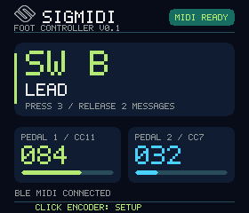 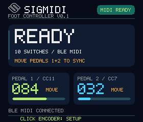

## Every element on the main screen

| Screen element | What it tells you |
|---|---|
| Icon, SIGMIDI and version | Controller identity and installed firmware version, at the top left. |
| MIDI badge, top right | USB MIDI: USB ready. USB+BLE: both ready. MIDI READY: BLE ready. CONNECTED: BLE linked without subscription. OFFLINE: no ready link. |
| Large SW label | The currently physically held switch, such as SW B. It is not a latched toggle-state display. |
| Name below the label | Your configured switch name; LEAD in the example. Long names use smaller text. |
| PRESS / RELEASE counts | Numbers of configured messages in those two lists. They are not counters of messages already sent. |
| READY at idle | No physical switch is held. The panel shows the installed count and USB + BLE instead of a switch name. |
| PEDAL 1 / CC11, etc. | Input number and configured CC. The MIDI channel is set in the pedal menu but is not displayed here. |
| Pedal number and bar | Hidden until that input first moves and sends a CC: --- is shown without a bar. Then the calculated output appears as 000-127 with a bar on the full MIDI scale. OFF means disabled; --- also indicates an invalid reading. |
| MOVE beside a pedal / MOVE PEDAL... TO SYNC | Move each indicated pedal to change its CC value. Its initial value has not yet been sent since boot, BLE readiness change or setup exit. The marker clears after that input sends successfully to BLE; it does not confirm the MIDI Device received it. |
| Notice line above footer | The most recent status or fault notice, such as a connection, save or ADC message. |
| CLICK ENCODER: SETUP | Navigation hint. Enter setup when all switches and pending actions are idle. |

The screen and optional LEDs show SIGMIDI's own state. They do not read back the MIDI Device's preset name, effect status or acknowledgement. A physical release returns the main panel to READY even when a toggle remains logically ON.

<!-- page -->

# 2.1 Switch behavior while playing

## Choose momentary or toggle independently

Switch type is the **TOGGLE** parameter on the device and **Toggle mode** in Wi-Fi. The hardware remains a momentary, non-latching footswitch in either case. This setting decides when its two message lists run; it does not change the MIDI message types inside them.

| Physical event | TOGGLE OFF: momentary | TOGGLE ON: toggle |
|---|---|---|
| First press | Run Press list. | Run Press list; logical state becomes ON. |
| Lift your foot | Run Release list. | No message; state stays ON. |
| Next press | Run Press list again. | Run Release list; state becomes OFF. |
| Next release | Run Release list again. | No message; state stays OFF. |

For a one-shot preset or command, use TOGGLE OFF with an empty Release list. For a temporary parameter change, use TOGGLE OFF with explicit high/low values in Press/Release. For a two-press on/off control, use TOGGLE ON with explicit on/off messages. The MIDI Device must assign those commands to the intended function.

## LEDs and state resets

With the optional chain enabled and a pixel assigned, momentary Press lights white and Release lights yellow. In toggle mode ON lights white and OFF goes dark. The color changes when the first message in that phase is accepted by BLE. Empty momentary lists leave the color alone; empty toggle lists still update the LED. A rejected action does not change the toggle state.

Each switch toggles independently. Runtime ON/OFF state is not saved: reboot, setup entry/exit and all-MIDI offline/online transitions reset all toggles to OFF, clear queued actions and clear LEDs. PC message counters have a separate persistence system (page 12). Manual operation or program changes on the MIDI Device can leave its state different from SIGMIDI's; explicitly establish a known starting state.

## Timing and playing technique

Use one footswitch at a time; simultaneous presses are unsupported. Holding a switch does not repeat its action. Every list runs in order, with the configured delay before each message. A quick release waits behind that switch's pending Press messages. Rapid accepted actions are queued; a full queue reports a notice.

After boot, leaving setup or a BLE readiness change, release all switches to rearm input detection. Move each enabled pedal until its MOVE marker disappears. A resting pedal sends no initial value, so the MIDI Device may retain its previous expression setting until you move it. A lost connection clears pending actions; reconnecting does not replay them. Setup pauses normal switch and pedal MIDI, so leave setup before playing. Explicit menu Test commands are the exception.

<!-- page -->

# 3. Editing Mode

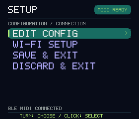 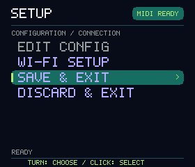

Editing Mode is the controller's **SETUP** state. It uses a draft configuration; Performance Mode uses the last saved configuration. Normal footswitch and pedal MIDI are paused throughout setup. Explicit Test actions can still send messages to the MIDI Device.

## Enter, save or discard

Click the encoder from Performance Mode when all switches and pending actions are idle. **EDIT CONFIG** opens the on-device editor. **WI-FI SETUP** starts the access point and displays SSID, KEY and HTTP address. **SAVE & EXIT** validates the draft, writes it to flash and resumes performance. **DISCARD & EXIT** restores saved settings and resumes performance. If validation or saving fails, read the notice and correct the draft before exiting.

## Encoder controls throughout local editing

| Gesture / cue | Effect |
|---|---|
| Turn while browsing | Move the selection; lists scroll beyond seven visible rows. |
| Click a menu or action | Open it or perform the selected command. |
| Click a parameter, then turn | Begin a value edit and change that value. |
| Click during a numeric/ON-OFF edit | Accept that field into the draft; it is not yet saved to flash. |
| Hold about 0.7 seconds while editing | Cancel the current field edit and restore its previous value. |
| Hold while browsing | Go back one menu level. At the configuration root, return to SETUP. |

Gray parameter names have aligned white values. Purple rows are actions. PC list entries are cyan and CC entries orange. The selected row has a highlight and > marker; an active edit uses amber and *. Breadcrumbs show the current path, and the right-hand scrollbar shows list position.

One editor owns the draft at a time. **BROWSER EDITING** means the browser has ownership. Holding the encoder takes ownership back **and discards the draft**. Save or export browser work before doing this. Wi-Fi saving and backup commands are on page 15.

<!-- page -->

# 3.1 Editing on Device

## Follow the screens to an existing message

Read left to right, then continue on the next row. At each menu, **turn to highlight the named item, then click**. This example edits an existing PC message on switch A in the Left variant; the same path works for another switch, its RELEASE list, or a CC message.

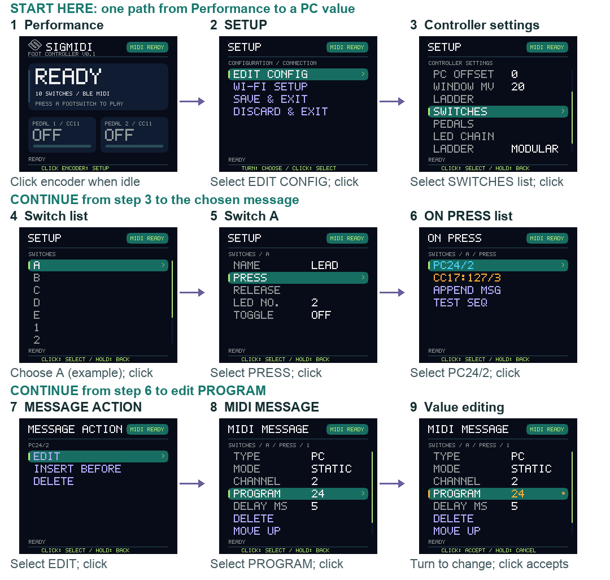

## Start with an empty list or change a different field

If PRESS is empty at step 6, select **APPEND MSG** to open a new message directly; there is no existing-entry MESSAGE ACTION screen. For a populated list, MESSAGE ACTION also offers INSERT BEFORE and DELETE. In step 8, choose TYPE, MODE, CHANNEL or another field instead of PROGRAM as needed.

A click in step 9 accepts the field into the draft. Hold about 0.7 seconds to cancel an active edit, or to return one level while browsing. Hold once per level to reach the configuration root for the routes on the next page. Hold once more to return to SETUP, then choose SAVE & EXIT to store the draft and play, or DISCARD & EXIT to cancel it. The SETUP screen and save controls are shown on page 5.

<!-- page -->

# 3.1 Screen paths to other menus

Use the common Performance > SETUP > EDIT CONFIG entry path on the previous page. Each row below starts at the **Controller settings** root. Turn to select the indicated row and click; only the highlighted item opens or edits.

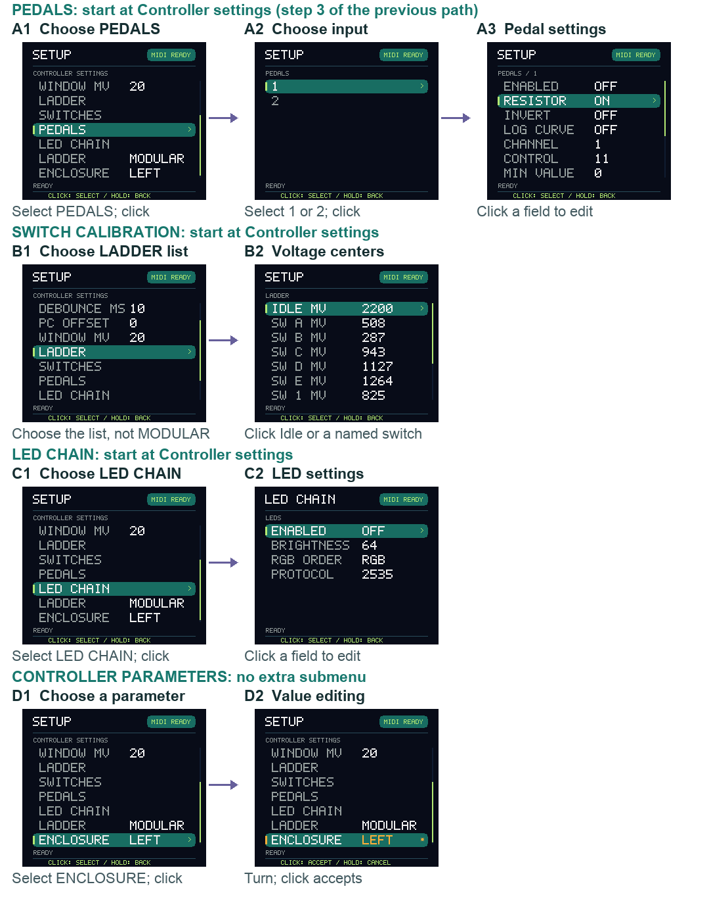

<!-- page -->

# 3.1.1 Controller settings

## Screen map: start at EDIT CONFIG

The following pages walk through every local menu. Uppercase labels below match the rendered LCD; some underlying section names appear as SWITCHES, PEDALS or LADDER. Hold to return from a child screen. Scroll through the whole configuration root: only seven rows fit at once.

| Root item, in order | Options and purpose |
|---|---|
| SCHEMA | Configuration format version, currently 6. Leave at 6; it is not the firmware version. Other values fail validation. |
| SWITCHES, numeric value | Installed switch count. MODULAR accepts 4/6/8/10; LINEAR accepts 4-10. Default 10. Lower counts hide unused mappings without deleting them. |
| DEBOUNCE MS | Stable-input time before a switch change is accepted; 2-100 ms, default 10. Increase only as needed for reliable switching. |
| PC OFFSET | Stored 0/1 preference. In v0.1 it has no display effect: Program fields, lists and transmitted numbers remain 0-127. |
| WINDOW MV | Acceptance half-width around each ladder center; 3-100 mV, default 20. All installed windows must be separated. |
| LADDER, opens a list | Idle and individual switch center voltages. See page 14. This is distinct from the later LADDER wiring selector. |
| SWITCHES, opens a list | Choose a physical switch, then its name, actions, LED and toggle setting. See page 9. |
| PEDALS | Choose input 1 or 2, then its electrical mode, response and CC settings. See page 13. |
| LED CHAIN | Enable and configure the optional LED chain. See page 14. |
| LADDER, MODULAR / LINEAR | Wiring/identity scheme. MODULAR is the four-switch base plus pairs; LINEAR is legacy tap order. Select the one actually wired. |
| ENCLOSURE, LEFT / RIGHT | One setting selects both screen rotation and row order. LEFT is default, screen on left; RIGHT is screen on right. |

**Why labels repeat:** a numeric SWITCHES row sets the count; a SWITCHES navigation row opens switch configurations. A LADDER navigation row opens calibration values; the scalar LADDER row selects wiring. Navigation rows have no separate value column.

Choose wiring, count and enclosure before calibrating. Switching from an odd Linear count to Modular rounds the draft count up to an even number. Changing the enclosure preserves each physical switch's MIDI actions, calibration and LED assignment. Draft lists reorder immediately; the LCD rotation follows the saved variant after saving.

The root also validates hidden mappings. If a save reports an invalid field or overlapping ladder windows, fix the indicated settings; reducing the visible count does not bypass message limits in hidden switches.

<!-- page -->

# 3.1.2 Switch screens

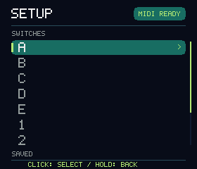 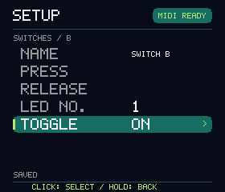

Open **EDIT CONFIG > SWITCHES** using the navigation row, then select A-E or 1-5. The switch list follows panel order: the upper row, then the lower row. Only installed switches are shown. Modular labels remain tied to their original physical switches as sections are added.

| Switch-detail item | What to edit |
|---|---|
| NAME | Your description, up to 24 characters. It appears under the active SW label during performance. |
| PRESS | Open the ordered Press list. In toggle mode this is the ON list. |
| RELEASE | Open the ordered Release list. In toggle mode this is the OFF list, run on the next press rather than on foot lift. |
| LED NO. | Physical chain pixel 1-10; OFF (0) disables this switch's indicator. Initial mapping pairs each electrical switch tap with the same-numbered pixel. |
| TOGGLE | OFF = momentary Press/Release; ON = alternate the lists on successive presses. Default OFF. See page 4. |

## Edit NAME on the device

Click NAME to start at the first character. Turn to choose space, A-Z, 0-9, hyphen or underscore, then click to advance to the next position. Continue through all 24 positions, including trailing spaces; the click after the final character accepts the name. Holding cancels the whole current name edit, rather than ending it early. The Wi-Fi text field is quicker for names.

## Choose the behavior before writing the lists

For a program-selection switch, set TOGGLE OFF, put a static PC in PRESS and leave RELEASE empty. For a momentary effect, put the desired active CC value in PRESS and the resting value in RELEASE. For a latched effect, use those same lists with TOGGLE ON. These are configuration patterns: the MIDI Device determines what the program or CC actually does.

Click accepts each setting into the draft. Hold back through the switch list and configuration root, then choose SAVE & EXIT to persist it. An empty list is valid and sends no MIDI. Two switches assigned the same LED share that indicator, so use separate pixel assignments when independent feedback is needed.

<!-- page -->

# 3.1.3 Action lists and message actions

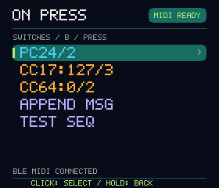

Open a switch's PRESS or RELEASE list. The title becomes **ON PRESS** or **ON RELEASE** even for toggle switches; toggle only changes when those lists execute. A new list contains APPEND MSG and TEST SEQ, with no message entries.

| Compact entry | Meaning |
|---|---|
| `PC24/2` | Static Program Change 24 on MIDI channel 2. |
| `CC17:127/3` | Control Change, controller 17, value 127, channel 3. |
| `PC+/2` / `PC-/2` | Incremental / decremental PC counter on channel 2. The current counter value is not shown in this list. |

Click an existing entry to open **MESSAGE ACTION**, whose breadcrumb identifies that message. Choose **EDIT** to open its fields, **INSERT BEFORE** to create a new message immediately ahead of it, or **DELETE** to remove it. Deletion acts immediately on the draft; there is no separate confirmation screen. Hold to return without choosing an action.

At the list's end, **APPEND MSG** creates a new message after all existing entries and opens its editor. New and inserted messages start as CC, channel 1, controller 0, value 0 and delay 5 ms. Set all fields for the intended command before testing. **TEST SEQ** sends this draft list when MIDI READY and the action queue is available; a notice reports success or offline/busy status.

To reorder, open a message's editor and scroll to MOVE UP or MOVE DOWN. DELETE is also available there. Each Press/Release list allows 32 messages. The whole configuration allows 128 across all ten saved switches, including hidden extension mappings. Each message may use a different channel.

Test sends can change the MIDI Device and advance PC counters. Testing one list does not alternate the performance toggle latch. It does not save the configuration. Return to SETUP and use SAVE & EXIT when the draft is ready.

<!-- page -->

# 3.1.4 MIDI message editor

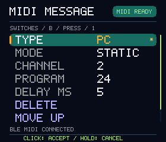 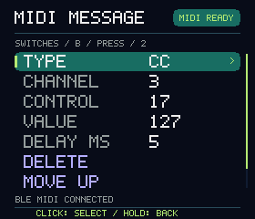

## TYPE and MODE are separate settings

TYPE offers **PC** or **CC**. For PC, MODE selects STATIC, INCR or DECR; the latter two appear in lists as PC+ and PC-. A list can mix any of these. Choose the type and mode first because they determine which fields are visible.

| Field / action | Options and effect |
|---|---|
| TYPE | PC recalls a program/preset; CC sets or triggers a controller function assigned by the MIDI Device. |
| MODE, PC only | STATIC sends PROGRAM; INCR uses PC+; DECR uses PC-. Counter behavior is on page 12. Hidden for CC. |
| CHANNEL | 1-16, independently for each message. Must match the intended receiver. |
| PROGRAM, STATIC PC only | MIDI program number 0-127. No VALUE field is shown or transmitted. |
| CONTROL, CC only | MIDI controller number 0-127; called Controller in Wi-Fi. Its meaning depends on the MIDI Device. |
| VALUE, CC only | MIDI value 0-127. This may mean an absolute level, off/on range or command, according to the receiver. |
| DELAY MS | 0-10000 ms, default 5. Wait before this message, measured from the preceding accepted message in the list. |
| DELETE / MOVE UP / MOVE DOWN | Remove the current entry or move it one position within the same list. Scroll to reach these action rows. |

Click a field, turn to change it and click to accept. Hold cancels the current field edit. Hold again while browsing returns to the list; choose TEST SEQ there. These fields are draft values until saved.

For a generic ordered action, send `PC24/2`, then `CC17:127/3`. Both begin with a 5 ms delay: the first waits after invocation and the second waits after the preceding send. Increase a later delay if the MIDI Device needs more processing time. Delay is per entry, not a single pause after the list.

Programs are always entered as wire numbers 0-127. If the MIDI Device displays 1-128, consult its MIDI mapping and enter the corresponding wire number; SIGMIDI does not apply PC OFFSET in v0.1. CC values are not automatically percentages. No note, SysEx or MIDI clock message type is available.

<!-- page -->

# 3.1.5 PC+ and PC- counters

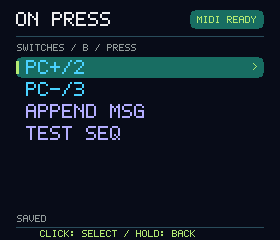 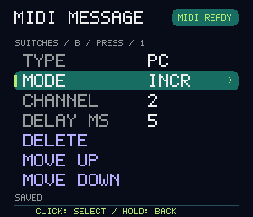

## Configure and use a counter

Open a message editor, choose TYPE PC and MODE INCR for **PC+**, or DECR for **PC-**, then choose CHANNEL and DELAY MS. Both Program and Value are hidden. Counter identity is managed internally and is not an editable menu field. A new message starts with counter value 0.

| Invocation after reboot | New PC+ message | Separate new PC- message |
|---|---|---|
| First successful send | Send stored value 0 unchanged. | Send stored value 0 unchanged. |
| Second successful send | Increment, then send 1. | Decrement, then send 127. |
| Third successful send | Send 2. | Send 126. |
| At a limit on later sends | 127 wraps to 0. | 0 wraps to 127. |

A restored counter behaves the same way: if its stored value is 24, its first successful invocation sends 24; the next sends 25 for PC+ or 23 for PC-. **Nothing is sent automatically at startup or connection.** Failed sends do not consume a step or the first-send behavior. Reconnection alone does not reset the first-invocation marker; reboot does.

Every configured counter message is independent, even on the same channel or in the same Press/Release list. Two switches containing PC+ and PC- are therefore not a shared up/down pair. To navigate relative to the MIDI Device's current selection, use its own next/previous CC commands if available.

## Persistence and editing

Changed values are retained immediately in the ESP32-S3's RTC slow memory. Every five minutes a background task checks for changes and, if necessary, checkpoints them to flash. A warm reset may recover retained state; power loss restores the last valid flash checkpoint, so recent changes can be lost. If nothing is stored, the value is 0.

Reordering a message preserves its counter; inserting a new message creates another counter. Changing channel or Left/Right does not allocate a new one. Deleting then recreating a message does. Explicit Test actions use the same counters. JSON export backs up mode and identity, not live counter values; saving configuration is not an immediate counter checkpoint.

<!-- page -->

# 3.1.6 Pedal screens

Open **EDIT CONFIG > PEDALS**, then input **1** or **2**. Each has the same options below; both inputs are configured independently. The external pedal is passive: either a two-wire variable resistor or a three-terminal potentiometer, up to 10 kOhm.

| Pedal field | Options, units and use |
|---|---|
| ENABLED | ON sends this input's calculated CC changes in performance; OFF disables it. Default OFF. |
| RESISTOR | ON for two-wire variable resistance; OFF for potentiometer mode. Unplug before changing, save and exit, then reconnect and calibrate. |
| INVERT | ON reverses the normalized travel direction before mapping to the output range; OFF keeps it. |
| LOG CURVE | OFF = Linear response; ON = logarithmic response, adjusted with CURVE. |
| CHANNEL | MIDI channel 1-16. Default 1. |
| CONTROL | CC number 0-127. Default 11. Assign the same CC to the desired MIDI Device function. |
| MIN VALUE | Output at the low end of the normalized travel; 0-127, default 0. |
| MAX VALUE | Output at the high end; 0-127, default 127. A narrower range limits the controlled parameter's excursion. |
| MAX OHMS | Full-scale resistance in resistor mode: greater than 0, up to 10000 ohms. Default 10000; encoder steps by 100 ohms. |
| HEEL | Lower measured endpoint in potentiometer mode, in mV. Default 0. See calibration procedure on page 16. |
| TOE | Upper measured endpoint in potentiometer mode, in mV. Default 3300; at least 50 mV above HEEL. |
| CURVE | Log response strength, 0.1-100, default 9; larger values give more output earlier in the travel. Ignored when LOG CURVE is OFF. |

MAX OHMS determines resistor-mode scaling; HEEL/TOE determine potentiometer scaling. Inactive fields remain visible and must still contain valid values to save. Endpoints must lie within 0-3300 mV with TOE at least 50 mV above HEEL. For opposite physical travel, enter low/high readings in that order and use INVERT.

For a general parameter pedal, choose the MIDI Device's assigned CC and channel, MIN VALUE 0, MAX VALUE 127 and Linear response first. Enable the input, save and exit, then move the pedal to test. A stationary pedal does not repeatedly send CC; invalid readings suppress output and appear as --- on the performance screen.

The local pedal menu edits endpoint numbers; it has no live capture action. Use Wi-Fi Calibration to capture HEEL/TOE, or enter the live mV readings manually. Both editors use the same unscaled endpoint values; see page 16.

<!-- page -->

# 3.1.7 Ladder and LED screens

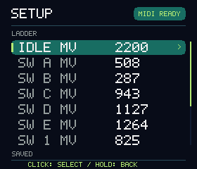 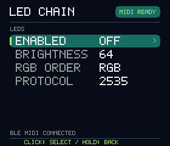

## LADDER calibration list

Open the **LADDER navigation row**, rather than the LADDER wiring selector. **IDLE MV** is the voltage with no switch held. **SW A MV**, etc. are the measured centers for installed switches, in the selected enclosure's order. Click, turn and accept a voltage in mV; values must be 0-3300. There is no local Capture command or live ADC display on this screen.

**WINDOW MV** is edited one level above, at the configuration root. It is the allowed deviation on each side of a center, not the full window width. Choose 3-100 mV and less than half the smallest gap between installed centers, including Idle. Windows touching or overlapping fail validation. Use the Wi-Fi procedure on page 16 to capture actual measurements.

## LED CHAIN menu

| Field | Options / use |
|---|---|
| ENABLED | ON/OFF; default OFF. Enable only when the optional chain is installed. |
| BRIGHTNESS | 0-255, default 64. Zero is dark even if the action is active. |
| RGB ORDER | RGB, GRB, BRG, BGR, RBG or GBR; choose RGB for Pololu 2535. |
| PROTOCOL | 2535, OLD 800K or OLD 400K. Choose 2535 for the specified LEDs; the OLD choices are legacy timing profiles. |

Assign a switch's pixel under its **LED NO.**, not here. White/yellow indicates momentary Press/Release; white/dark indicates toggle ON/OFF. Feedback is local to an accepted MIDI send, not a response from the MIDI Device. Save before testing changed chain settings: explicit Test actions use the saved LED configuration. Startup, setup transitions and readiness changes clear latched colors.

Hold back to EDIT CONFIG, hold again to SETUP, then SAVE & EXIT. If the browser owns the draft, the BROWSER EDITING screen replaces local menus; page 5 explains how to return ownership without accidentally losing work.

<!-- page -->

# 3.2 Editing over Wi-Fi

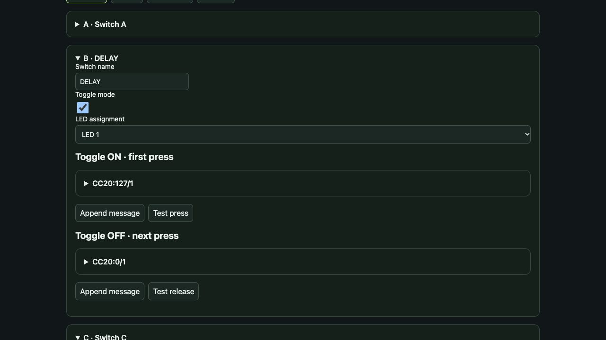

## Open the editor and select a screen

1. In SETUP choose WI-FI SETUP. Join the displayed `SIGMIDI-xxxx` network with the LCD's KEY. Stay connected if your phone reports no internet.
2. Open **http://192.168.4.1/** and enter the same password. The editor works without internet. The LCD shows BROWSER EDITING while this browser owns the draft.
3. **Switches** edits names, Toggle mode, LED assignments and On press/On release lists (Toggle ON/OFF when enabled). Expand a message for TYPE, PC mode, channel, number/value and delay. Use Append message, Insert before, Delete and up/down controls.
4. **Pedals** contains each input's mode, calibration, response and CC output settings. **Calibration** shows switch capture rows and pedal endpoint commands. **Settings** contains count, wiring, enclosure, debounce, PC offset and LED chain settings.

**Test press / Test release** send the corresponding draft list to the MIDI Device. They can advance counters and change the sound; they do not advance the performance toggle latch. Normal pedal and footswitch MIDI remains paused until setup ends.

## Save and back up

**Save** persists the draft and stays in setup. **Save & exit** also resumes performance and stops Wi-Fi. **Discard changes** restores saved settings; **Reload draft** fetches the current controller draft. **Export JSON** backs up configuration; **Import JSON** loads a draft, which must then be saved. Live PC counter values are not in JSON backups.

One browser edits at a time. Finish or export its work before holding the encoder to take over: that action discards the draft. Changes accepted into a local field or browser field are not persistent until a save succeeds.

<!-- page -->

# 3.3 Calibration workflow

## Match the layout, then measure the ladder

1. Set Enclosure variant, Ladder wiring and Number of footswitches in Wi-Fi Settings, or the corresponding on-device root fields. Adding an extension does not update the count automatically.
2. Open Wi-Fi Calibration. With no switch held, use Capture on Idle. Hold exactly one named switch, capture that row, then release it. Repeat for every installed switch.
3. Set Acceptance half-width (WINDOW MV on the LCD) to contain stable readings while remaining strictly below half the smallest gap between centers. Include Idle in that comparison.
4. Save & exit, release all switches and verify every physical switch in Performance Mode. The active SW label should match the panel.

Voltage input fields display whole millivolts. Untouched values and switch captures keep their stored precision; an explicit edit uses 1 mV steps. Capturing into the wrong row associates the wrong voltage with that physical action, so follow the displayed label rather than an assumed numeric tap order.

## Calibrate a passive continuous pedal

| Electrical mode | Scaling to configure |
|---|---|
| Two-wire resistor, RESISTOR ON | Set MAX OHMS to its full-scale resistance, up to 10000. Conversion assumes a near-zero low end; HEEL/TOE do not scale this mode. |
| Potentiometer, RESISTOR OFF | Measure both endpoints. Capture the lower-voltage endpoint as HEEL and the higher as TOE; their difference must be at least 50 mV. |

Unplug before changing electrical mode. Save and exit so the saved mode is applied, reconnect the pedal, then return to setup to measure it. In Wi-Fi Calibration, move to the lower-voltage endpoint and click **Capture pedal 1 heel** (or input 2); move to the higher endpoint and click **Capture pedal 1 toe**. Captures store raw ADC millivolts without scaling and retain measurement precision. Fields display whole mV. You can also enter the live readings manually in Pedals or the local menu. Save the calibration before returning to performance.

If the physical travel runs the opposite way, retain the valid low/high endpoint order and enable INVERT. Choose Linear first, then Logarithmic and CURVE if desired. Set the MIDI Device's assigned CC/channel and output range, enable the input, save and exit. Move the pedal after returning to performance to test its output. Calibrate inputs 1 and 2 separately.

## Check the result before performance

Confirm MIDI READY; exercise every installed switch; check both pedal extremes and a mid-position. Verify optional LED assignments and brightness. Then export the configuration JSON. Recalibrate after changing the ladder, switch count or pedal wiring. A saved configuration does not establish the MIDI Device's effect states; use explicit actions to set a known state.

<!-- page -->

# 4. Troubleshooting

| Symptom | Check or corrective action |
|---|---|
| OFFLINE | Open the MIDI Device's BLE MIDI interface and reconnect to SIGMIDI. If using an adapter, follow its central-role procedure. |
| CONNECTED but no MIDI | The receiving central must subscribe to BLE MIDI notifications; reconnect through its MIDI interface. |
| MIDI READY, no response | Exit setup; check channel, the MIDI Device's PC/CC receive settings, command mapping and nonempty action list. Test one message. |
| Wrong program | Confirm the MIDI Device's wire program number; fields are always 0-127, regardless of its display numbering. |
| CC changes the wrong function | Check that device's CC map and per-program assignments. CC numbers have no universal effect or parameter meaning. |
| Toggle LED disagrees with sound | LED state is local feedback. Program changes or manual controls can change the MIDI Device independently. Establish a known state. |
| First PC+ or PC- does not step | Intended after reboot: first successful invocation sends its stored number unchanged. Separate messages have separate counters. |
| Missing / wrong switch label | Check count, Modular/Linear and Left/Right. Capture Idle and each switch into the correctly named row. |
| Can't enter setup | Release all switches and allow pending actions to finish, then click the encoder. |
| Save does not exit | Read the notice. Check MIDI ranges, 32/128 message limits, ladder-window separation and pedal endpoint validity. |
| Pedal OFF / --- / no change | Enable it, check saved electrical mode, recapture valid endpoints, then move it after leaving setup. |
| Wi-Fi unavailable | Start WI-FI SETUP, join its network and open HTTP at 192.168.4.1. Save & exit stops the access point. |
| Can't edit locally | BROWSER EDITING means browser ownership. Save/export there first; encoder hold takes over and discards the draft. |
| LED dark / wrong color | Check chain enable, brightness, pixel assignment and saved RGB/timing choices. Performance actions require MIDI READY. |

This guide documents firmware v0.1 and configuration schema 6, checked against the current firmware on 29 October 2026. It describes operation and configuration; hardware wiring and mechanical assembly are covered by the project's Hardware, LEDs, Power, Resistor ladder and printing guides. Appendix A contains one device-specific practice rig; it does not change the general operating procedures above.

<!-- page -->

# Appendix A. HX Stomp example

## A.1 Connect and pair a BLE MIDI dongle

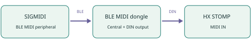

This appendix applies SIGMIDI's general controls to **Line 6 HX Stomp**. HX Stomp and the BLE MIDI dongle are examples; use the MIDI reference for your own device elsewhere. The complete SIGMIDI/dongle/HX rig has not been bench qualified. Line 6, HX Stomp and CME names belong to their respective owners.

## Example: CME WIDI Master pairing

The dongle must connect as BLE MIDI **central** to SIGMIDI. A peripheral-only dongle cannot form this direct link.

1. Power HX Stomp with its own supply. Link WIDI Master's small sub-adapter to the main adapter; plug the large adapter into HX MIDI OUT for power and the small adapter into MIDI IN. Check the dongle powers up. [S3]
2. With other BLE controllers off, use WIDI App to update/configure the dongle if needed. Leave its role able to act as central, rather than Force Peripheral. [S3]
3. Disconnect the app and prevent a phone/tablet from reconnecting to the dongle. Power SIGMIDI and the HX/dongle. WIDI Master's documented third-party-controller auto-pairing should attempt the link. If it fails, follow CME's compatibility/pairing guidance. [S3]
4. Check the dongle's connection indicator and **MIDI READY** on SIGMIDI. CONNECTED alone is insufficient. Release all switches before testing. No PC value is sent automatically at startup.

## Set up HX Stomp reception

On HX Stomp set MIDI Base Channel to **1** and enable MIDI PC reception from DIN (MIDI or MIDI+USB, as offered by its firmware). All appendix recipes use channel 1. Keep guitar/audio routing on HX Stomp; SIGMIDI sends control data only. [S1, p.60]

First try one static PC as on page 19, then add CC assignments. If pairing fails, check dongle power, central role, competing connections and SIGMIDI readiness before debugging preset numbers. Consult the current dongle guide for firmware-dependent pairing controls; there is no SIGMIDI pairing menu.

<!-- page -->

# A.2 Prepare existing patches

## Know the address of the sound you want

On HX Stomp, open its Preset list from Play view and read the **PC:xxx** helper text. Use that value directly as SIGMIDI PROGRAM: do not add 1 or derive it from an assumed A/B/C bank formula. The Line 6 illustration identifies **Pastor of Muppets** with PC061, but use your unit's actual readout if its preset has moved. [S1, pp.13,65]

The following real patch names are useful starting points: **Pastor of Muppets** appears in the owner's manual; **Placater Dirty** and **Outtake** are named factory-preset examples in Line 6's tutorial index. Factory content and installed locations vary. [S1; S2]

## Reproducible practice copies

Back up HX Stomp first. Copy those existing patches to unused locations and keep the originals intact. For the numerical recipes below, use spare locations whose HX MIDI readouts are PC010, PC011 and PC012. These are chosen lesson destinations, not claims about factory locations. If these slots are occupied, choose others and replace every corresponding PC number in the recipes. If a named patch is absent, substitute an existing patch and inspect its available blocks before assigning controls.

| Existing patch copied to a spare location | Lesson PC readout | SIGMIDI name | Press message |
|---|---|---|---|
| Pastor of Muppets | PC010 | MUPPETS | `PC10/1` |
| Placater Dirty | PC011 | PLACATER | `PC11/1` |
| Outtake | PC012 | OUTTAKE | `PC12/1` |

## Configure a preset switch

For switch **A**, set NAME to MUPPETS and TOGGLE OFF. In PRESS, append PC, mode STATIC, channel 1, Program 10 and Delay 5 ms. Leave RELEASE empty. Save and exit. One press loads the practice copy; releasing sends nothing. Repeat on B with Program 11 and on extension C with Program 12.

To recall the manual's unmodified example directly, use `PC61/1` only if your current HX readout confirms PC061 for Pastor of Muppets. Program changes select a whole preset; they do not require per-block CC assignments.

**Use valid MIDI numbers.** The supplied reference's CC128 row is a joke, not a usable message. CC numbers stop at 127. The guide uses only valid messages; the full curated command list is on page 24.

<!-- page -->

# A.3 Snapshots and ordered actions

 

## Select a snapshot in the current preset

Configure a momentary switch with a single Press CC and an empty Release list. The supplied reference uses **CC69** for snapshot selection: 0 selects Snapshot 1, 1 selects Snapshot 2 and 2 selects Snapshot 3. [U]

| Example switch name | Press list | Delay | Release list |
|---|---|---|---|
| SNAP 1 | `CC69:0/1` | 5 ms | Empty |
| SNAP 2 | `CC69:1/1` | 5 ms | Empty |
| SNAP 3 | `CC69:2/1` | 5 ms | Empty |

HX Stomp has three snapshots per preset. Do not use value 3 as a fourth snapshot on this model, despite that row in the supplied CC table. Prepare and save the intended sound in each snapshot first. [S1, p.43]

## Recall a preset and then its snapshot

For A, build a Press list with these two entries in order. TOGGLE stays OFF and RELEASE stays empty.

| Order | Type / mode | Channel | Program or Controller | Value | Delay before |
|---|---|---|---|---|---|
| 1 | PC / STATIC | 1 | Program 10 | Hidden | 5 ms |
| 2 | CC | 1 | Controller 69 | 1 | 5 ms |

The compact list reads `PC10/1`, then `CC69:1/1`. This loads the MUPPETS practice copy and selects its prepared Snapshot 2. The wait before the second message is relative to the preceding accepted message. Recent HX documentation describes buffering CC69 during preset loading; verify the result on your firmware. Increase the second delay if the complete rig needs more time. [S1, p.66]

Use the same pattern for the other copies, changing only Program and the snapshot value. Editing a preset or snapshot on HX can change block states, so SIGMIDI's latched LEDs must not be treated as snapshot or effect feedback.

<!-- page -->

# A.4 Control effects and parameters

## Recipe A: latch an existing effect on and off

In the MUPPETS practice copy, choose the Harmony Delay block shown in Line 6's example, if present. Otherwise choose an existing delay block. Assign its **Bypass MIDI In** to an unused CC20 and save the HX preset. Incoming low values bypass the assigned block; high values enable it. Make the starting state bypassed. [S4]

| SIGMIDI switch 1 | Setting |
|---|---|
| NAME / TOGGLE | DELAY / ON |
| PRESS | CC, channel 1, Controller 20, Value 127, Delay 5 ms |
| RELEASE | CC, channel 1, Controller 20, Value 0, Delay 5 ms |
| Compact lists | `CC20:127/1` / `CC20:0/1` |

First press enables the delay and lights white. Lifting your foot does nothing. The next press bypasses the delay and extinguishes the LED. Optional LEDs must be enabled. This uses a direct block assignment, so it does not depend on HX's current footswitch mode. CC20 is a chosen user assignment, not a universal delay command.

## Recipe B: momentary parameter lift

In the PLACATER practice copy, select an existing amp's Drive parameter. Assign it to MIDI CC21 in Controller Assign, set Min to 3.0 and Max to 5.0 (or valid nearby values for that block), and save. If CC21 is already used, choose another free, non-reserved CC and change both ends. [S4]

Set an available SIGMIDI switch to NAME DRIVE LIFT, TOGGLE OFF, Press `CC21:127/1` and Release `CC21:0/1`, each with 5 ms delay. Holding the switch requests the maximum Drive; release returns to the minimum. MIDI Value 127 means the assigned maximum, not Drive 127. The same method can use an existing Outtake delay's Mix, with a proposed Min 20% and Max 35% instead; these are example settings, not claims about its factory blocks or values.

## Make the assignment on HX Stomp

For bypass, open Bypass Assign and select the block's MIDI In CC. For a parameter, hold its parameter knob to open Controller Assign, choose MIDI CC, set CC#, then Min/Max. Learn is an alternative: send the intended CC while Learn is active. Save the HX preset as well as SIGMIDI's configuration. [S4]

Do not use a reserved global CC for these assignments. The supplied reference's CC75-77 controls whichever parameter knobs are currently displayed; that is convenient for editing but less predictable than a dedicated per-parameter CC for a live show. [U]

<!-- page -->

# A.5 Commands and expression control

## Trigger an HX command once per press

Keep TOGGLE OFF and RELEASE empty for these commands. Adding an unconditional release message can trigger a second command. All rows below use channel 1 and 5 ms delay. [U]

| Name | Press message | Use |
|---|---|---|
| TAP | `CC64:127/1` | Tap repeatedly to set HX tempo. SIGMIDI does not send MIDI clock. |
| TUNER | `CC68:127/1` | Trigger tuner screen on/off; this is not a value-based LED latch. |
| PREVIOUS | `CC72:0/1` | Request previous HX preset. |
| NEXT | `CC72:127/1` | Request next HX preset. |

HX footswitch emulation CC49-53 acts on the switch's current assigned function, which can depend on the HX footswitch mode. Use a direct PC, snapshot CC or assigned block/parameter CC when you want the same result regardless of that mode. [U]

## PC counters versus HX-relative stepping

PC+ and PC- are independent absolute program counters (page 12), not a shared next/previous control tracking HX's selected preset. Use the CC72 recipes above for relative HX navigation. Keep their Release lists empty so lifting your foot does not trigger a second step.

## Control HX parameters with continuous pedals

In SIGMIDI Pedals select channel 1, CC1 for HX EXP1 or CC2 for EXP2, output range 0-127 and Linear response to start. Enable the input and calibrate it using page 16. The HX preset must assign the intended parameter to the corresponding expression controller. [U]

Alternatively, use CC21 and assign it directly to the desired HX parameter as on page 21. Save both devices, leave SIGMIDI setup and move the pedal. The parameter's HX Min/Max settings determine its sound range; SIGMIDI's output is MIDI data, not a literal amp Drive or effect Mix value.

<!-- page -->

# A.6 Stage layout and looper

## Start with four switches, extend when needed

This layout uses the practice addresses on page 19. All MIDI channels are 1 and all new-message delays are 5 ms. Add the snapshot message after A's PC in the order shown. Except DELAY, leave TOGGLE OFF and RELEASE empty. Use the Left layout for A-E / 1-5 from left to right; Right reverses the physical order within each row.

| Switch | Name | Press list | Release list / mode |
|---|---|---|---|
| A | MUPPETS | `PC10/1`, `CC69:1/1` | Empty; momentary |
| B | PLACATER | `PC11/1` | Empty; momentary |
| 1 | DELAY | `CC20:127/1` | `CC20:0/1`; Toggle ON |
| 2 | TAP | `CC64:127/1` | Empty; momentary |
| C | OUTTAKE | `PC12/1` | Empty; momentary |
| 3 | SNAP 3 | `CC69:2/1` | Empty; momentary |
| D | SNAP 1 | `CC69:0/1` | Empty; momentary |
| 4 | PREVIOUS | `CC72:0/1` | Empty; momentary |
| E | SNAP 2 | `CC69:1/1` | Empty; momentary |
| 5 | NEXT | `CC72:127/1` | Empty; momentary |

The base needs only A, B, 1 and 2. A six-switch unit adds C/3; eight adds D/4; ten adds E/5. Configure CC20 in every HX preset where DELAY should work. Otherwise it may do nothing or control a different existing assignment. Snapshot switches act within the currently loaded preset.

## Optional looper substitutions

If the current HX preset contains a suitable Looper block, replace spare switches with these Press-only CC commands. Use TOGGLE OFF and an empty Release list unless you deliberately want alternate explicit commands. The supplied reference defines the following values. [U]

| Control | CC / value | Control | CC / value |
|---|---|---|---|
| Record | 60 / 127 | Overdub | 60 / 0 |
| Play | 61 / 127 | Stop | 61 / 0 |
| Play once | 62 / 127 | Undo/redo | 63 / 127 |
| Forward | 65 / 0 | Reverse | 65 / 127 |
| Full speed | 66 / 0 | Half speed | 66 / 127 |

Before a show, load each intended preset and test every assigned switch and pedal. Saving both devices and exporting the SIGMIDI JSON gives you a repeatable starting point. After a setup/reset, explicitly establish the required HX block states rather than relying on a dark SIGMIDI toggle LED to prove that the block is bypassed.

<!-- page -->

# A.7 HX MIDI reference

The supplied table is the starting reference [U]. The table below retains its useful commands while omitting the invalid CC128 joke and unused entries. Values are MIDI data values, not parameter percentages. All messages also need the correct MIDI channel.

| Message | Value | Intended function |
|---|---|---|
| PC, STATIC | Program 0-127 | Recall the preset identified by HX's PC helper readout. |
| CC1 / CC2 | 0-127 | Emulate EXP1 / EXP2. The preset's assignments decide the destination. |
| CC20 (chosen) | 0 / 127 | Assigned delay block bypass / enable in this guide. |
| CC21 (chosen) | 0 / 127 | Assigned parameter Min / Max in this guide. |
| CC49 / 50 / 51 / 52 / 53 | 0-127 | Emulate HX FS1 / FS2 / FS3 / FS4 / FS5. |
| CC60 | 0-63 / 64-127 | Looper overdub / record. |
| CC61 | 0-63 / 64-127 | Looper stop / play. |
| CC62 / CC63 | 64-127 | Looper play once / undo-redo. |
| CC64 | 64-127 | Tap tempo. |
| CC65 | 0-63 / 64-127 | Looper forward / reverse. |
| CC66 | 0-63 / 64-127 | Looper full / half speed. |
| CC68 | 0-127 | Trigger tuner screen on/off. |
| CC69 | 0 / 1 / 2 | HX Stomp Snapshot 1 / 2 / 3. |
| CC69 | 8 / 9 | Next / previous snapshot. |
| CC70 | 0-63 / 64-127 | All bypass / active processing. |
| CC71 | 0-127 | MODE command; behavior depends on the device's available modes. |
| CC72 | 0-63 / 64-127 | Previous / next preset. |
| CC73 | 0-127 | Toggle HX Play/Edit view. |
| CC75 / 76 / 77 | 0-127 | Global control of displayed parameter knobs 1 / 2 / 3. |
| CC81 | 0-63 / 64-127 | Page Left / Page Right. |

**Model and firmware matter.** Standard HX Stomp has three snapshots; the fourth-snapshot text in the supplied table is not used here. Treat reserved CCs as unavailable for custom assignments. The reference's CC74 reservation conflicts with Line 6's 3.15 release note describing a preset-save command; this guide deliberately assigns neither CC74 nor undocumented reserved commands. Consult your firmware's documentation before using them. [S1, p.43; S5]

SIGMIDI v0.1 sends PC and CC only, with per-message channels and delays. It does not generate MIDI clock, SysEx, note messages or an automatic program-state synchronization with HX Stomp. The displayed PC offset setting does not change the wire number: enter the 0-127 PC readout itself.

<!-- page -->

# A.8 Example sources and checks

## Source notes and scope

**[U] User-supplied HX Stomp MIDI CC reference image.** Used for the command/value recipes and reference table. It includes inconsistencies noted in Appendix A; CC128 is not a valid MIDI controller number.

**[S1]** [Line 6 HX Stomp 3.80 Owner's Manual](https://line6.com/data/6/0a00051afdda673cccdb61c9c/application/pdf/HX%20Stomp%203.80%20Owner%27s%20Manual%20-%20English%20.pdf), pp.13,43,60,65-67: address readouts, snapshot count, receive settings and preset/snapshot sequencing.

**[S2]** [Line 6 HX Stomp tutorials by Jason Sadites](https://kb.line6.com/hx-stomp-tutorials-by-jason-sadites): published Placater Dirty and Outtake factory-preset examples.

**[S3]** [CME WIDI Master start guide](https://www.cme-pro.com/widi-master-start-guide-bluetooth-midi/): adapter connections and third-party BLE controller pairing. This is an example dongle workflow, not a claim of tested SIGMIDI compatibility.

**[S4]** [Line 6 HX Stomp Owner's Manual, MIDI assignment instructions](https://line6.com/data/6/0a020a4010c935bb66a4c0c44f/application/pdf/HX), p.48: block bypass and parameter CC assignment.

**[S5]** [Line 6 firmware release notes, 3.15 features](https://line6.com/software/index.html?hardware=HX+Stomp&name=Firmware&submit_form=set): global parameter controls and the CC74 preset-save note.

SIGMIDI behavior and illustrations were checked against this project's current firmware, menus and documentation on 29 October 2026. The examples leave existing firmware and hardware configuration untouched; validate the full wireless rig before relying on it live. General troubleshooting is on page 17. Recheck all assignments after changing HX presets or dongle firmware.
## Validate this example rig

Verify one PC, one assigned CC, every snapshot command, both pedal endpoints and each toggle's two presses. Test after reboot and after reconnecting BLE. A dark toggle LED does not prove the HX block is bypassed. Use an explicit command or known preset state before playing.

The example patch destinations PC010/011/012 are practice locations, not guaranteed factory addresses. Read HX's actual PC helper before entering a Program value. Save changes on HX as well as SIGMIDI and export the SIGMIDI JSON. Follow the dongle maker's current pairing instructions if its application or firmware differs from the example on page 18.
