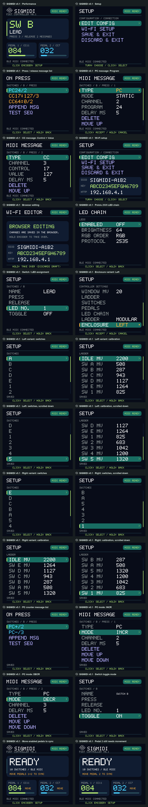

# SIGMIDI Foot Controller v0.1 — Previews

## Enclosure renderings

**Left is preferred**, with electronics on the left and extensions to the right. [Left main](sigmidi-left-main.png) · [Left modular](sigmidi-left-modular.png) · [Right main](sigmidi-right-main.png) · [Right modular](sigmidi-right-modular.png).

### Left

[Main top](../design/fusion/mirrored/main/top.png) · [Assembly](../design/fusion/mirrored/main/assembled.png) · [Rear](../design/fusion/mirrored/main/rear.png) · [Exploded](../design/fusion/mirrored/main/exploded.png) · [Display underside](../design/fusion/mirrored/main/display-underside.png) · [Base mounts](../design/fusion/mirrored/main/base-mounts.png) · [25 mm embossed icon](../design/fusion/mirrored/main/embossed-icon.png).

[Modular top](../design/fusion/mirrored/modular/top.png) · [Modular assembly](../design/fusion/mirrored/modular/assembled.png) · [Modular exploded](../design/fusion/mirrored/modular/exploded.png) · [Assembly guide](../design/fusion/mirrored/README.md).

### Right

[Top](../design/fusion/panel-top.png) · [Rear](../design/fusion/rear.png) · [Internal layout](../design/fusion/internal.png) · [Base supports](../design/fusion/base-supports.png) · [Labels](../design/fusion/switch-labels.png) · [Modular assembly](../design/fusion/modular/modular-assembled.png) · [Print orientations/supports](../design/fusion/print/printing-orientations-supports.png).

[Converter clips](../design/fusion/clip-mount.png) · [Base vents](../design/fusion/ventilation-base.png) · [Rear vents](../design/fusion/ventilation-rear.png) · [Vent membrane section](../design/fusion/rear-vent-membrane-section.png) · [Joint clearance sections](../design/fusion/snug-fit-sections.png).

Renders come from native Fusion geometry; manifests record image hashes. Presentation sheets are generated with `scripts/brand_enclosure_previews.py`.

## Firmware LCD

The production renderer and `tests/display_preview.cpp` menu harness generate the 280×240 native screens `01.png`–`18.png` and contact sheets. Run `python3 scripts/preview_display.py` with Pillow, a C++17 compiler and ESP-IDF cJSON sources.

[Performance overview](display-overview.png) · [PC/CC forms](menu-editor-preview.png) · [LED settings](led-menu-preview.png) · [Enclosure selector](enclosure-menu-preview.png).

[Left/Right switch and calibration menus](enclosure-menus-both-variants.png) · [Scrolled continuation](enclosure-menus-scrolled.png). Left is the left column; Right is the right column. Captures use ten-switch defaults and are upright for the matching enclosure.

## Wi-Fi editor

[PC editor](wifi-pc-editor.png) · [CC editor](wifi-cc-editor.png) · [Settings](wifi-settings.png) · [Calibration](wifi-calibration.png).

[Both switch lists](wifi-switches-both-variants.png) · [Both calibration lists](wifi-calibration-both-variants.png). Left reads A–E / 1–5; Right reverses each row. Calibration fields display whole millivolts. Actions, calibration and LED assignments remain attached to physical taps.

Full pages: [Left switches](wifi-left-switches.png), [Right switches](wifi-right-switches.png), [Left calibration](wifi-left-calibration.png), [Right calibration](wifi-right-calibration.png). Screenshots use the production editor with simulated default configuration and example actions, without a hardware connection. `scripts/preview_wifi.py` serves the demo; `scripts/compose_wifi_variant_previews.py` assembles comparisons.

## Installer and branding

[Web flasher](web-flasher.png) shows the installer with verified firmware, a Left enclosure render and Supported hardware details. [Run instructions](../docs/web-flasher.md).

[Brand assets](../design/branding/README.md) share the supplied SIGMIDI outline across LCD, Wi-Fi editor, installer and presentation sheets. [Render metadata](sigmidi-enclosure-renders.json).

## Cable routing proposal

[Interactive Left layout](cable-bundles-left.html) · [Full layout](cable-bundles-left.png) · [Electronics detail](cable-bundles-left-detail.png) · [SVG](cable-bundles-left.svg). Select a purpose in the interactive view to isolate that harness. Colors distinguish 9 V input, regulated 5 V, ground, switch ladder, expression pedals, LCD, encoder and optional LEDs.

Component footprints come from the Left main CAD assembly. Power/LED corridors use the model references; the analog/LED interface area and other routing are proposals. Lines show bundle corridors rather than shared electrical nets. Vertical clearance, carrier mounting and connector placement require review before building. The preview does not change Fusion geometry or firmware settings.

## Electrical diagram

[KiCad schematic preview](kicad-schematic.html) · [Native project and verification](../design/kicad/README.md). The vector preview is exported by KiCad from the editable schematic; use the zoom controls for pin details. Refresh it with `python3 scripts/preview_kicad.py` after exporting the current KiCad SVG, PNG, XML netlist and Konnect pin locations.

[Single-page browser preview](electrical-single-page.html) · [Single-page A0 PDF](../output/pdf/sigmidi-electrical-single-page.pdf) · [Seven-sheet browser preview](electrical-diagram.html) · [A3 PDF](../output/pdf/sigmidi-electrical-diagram.pdf) · [SVG sheets, BOM and terminal schedule](../design/electrical/README.md).

The unified single-page schematic shows one DFRobot board with continuous wires to every component, including complete 3V3, 5V and ground rails. Dots indicate joins; arched crossings do not connect. DFRobot pins retain the physical top view: USB-C up, P2 left, P1 right, with the four-pitch P1 offset. Larger printed-pin and logical-GPIO labels sit inside the outline. The LCD retains external P2 connector order 1-8 (BL, RST, D/C, CS, CLK, DIN, GND, VCC). One J2 ACJS-MHDC box contains both pedal ports, pedal 1 above pedal 2. The encoder is beside the A/B pins, and the bias and ground routes use the open space below the boards. The surrounding components are placed around their controller connections. Its drawn terminal and wire geometry is checked against the component netlist. The detailed sheets cover the DFRobot DFR1075 P1/P2 headers, Waveshare 24382 external connector, power input, encoder, modular 4/6/8/10-switch ladder, two selectable pedal inputs and optional Pololu 2535 LEDs. Purchased boards stop at their external pins. A DFRobot top-view outline shows physical board labels beside logical GPIO names and external nets; unused external NC callouts are omitted while every printed board label remains visible; the terminal CSV includes both names. The encoder is a five-pin box wired directly to D12/GPIO6, D11/GPIO7, RX/GPIO17 and GND, using firmware internal pull-ups without external parts. Pin references were checked against manufacturer documents and the firmware assignments. Each passive pedal input uses only two controller resistors (5.1 kΩ reference and 10 kΩ bias), with no active interface or scaling divider; matching firmware uses direct ADC millivolts and HIGH/high-impedance bias control. LED boxes use the Pololu 2535 side-view lead order (DIN/5V/GND/DOUT), with direct GPIO16 data and only LEDs and wiring in the chain. Hardware verification remains required. Regenerate with `scripts/preview_electrical.py` using Python with ReportLab and the companion `scripts/unified_electrical.py` renderer.
