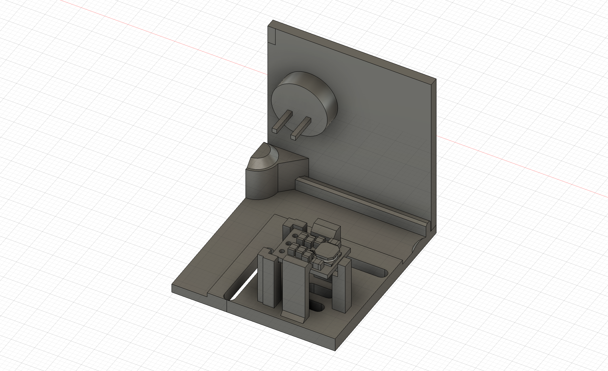
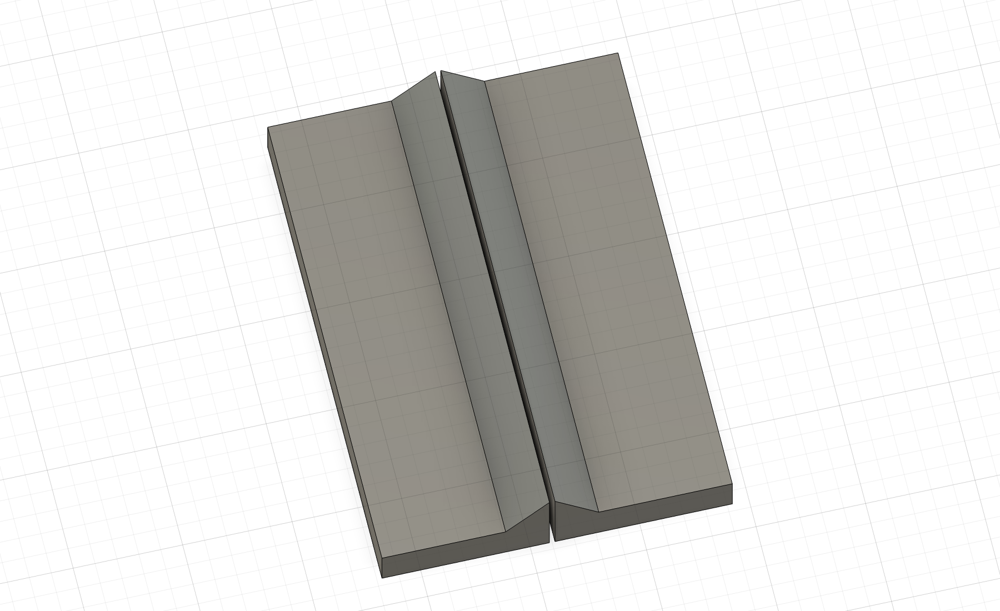
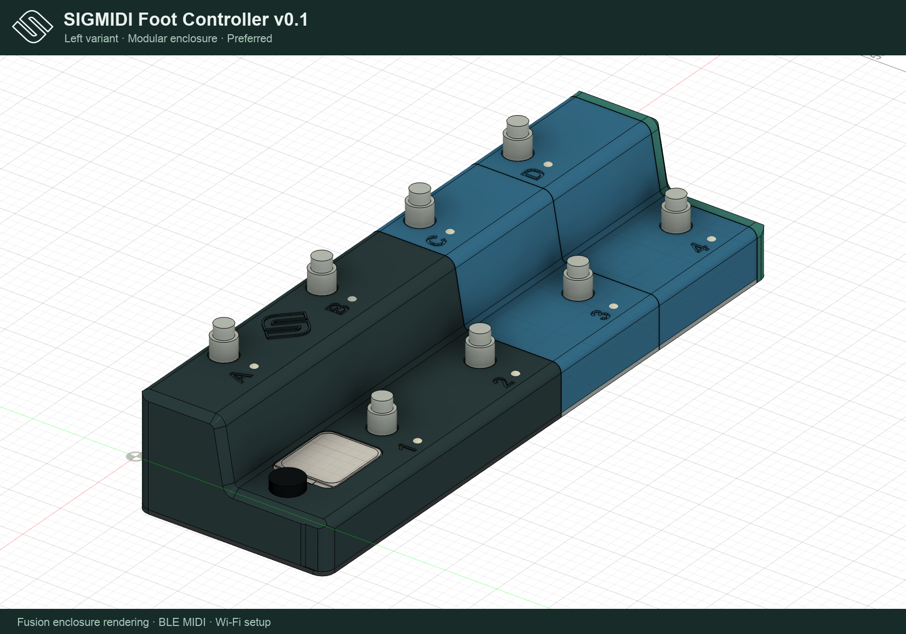

# SIGMIDI Foot Controller v0.1 — Current previews

## Enclosure

**Left is the preferred variant and the default for new firmware configurations.** Its electronics are on the left, with switch-pair extensions added on the right. See the [Left assembly and print guide](../design/fusion/mirrored/README.md). Original Right-variant technical detail views below remain labeled references.

These images are captured from the current native Fusion model with the 9 V center-negative power input, raised PETG Pololu clip mount and expanded base grilles and raised rear ventilation, straight base glue lips, a full-outline bearing base and one universal pair base. Upper joint and base locator clearances are now 0.20 mm for the calibrated 0.6 mm PETG process. Front and rear positioning ribs are 1.8 mm thick, with four clear gaps merged into three continuous runs; screw and USB reliefs remain open. The manifest records native geometry provenance and image hashes: [CAD render manifest](../design/fusion/render-manifest.json).

[Recessed switch labels](../design/fusion/switch-labels.png) · [Exact top projection](../design/fusion/panel-top.png) · [Rear connectors](../design/fusion/rear.png) · [Internal layout](../design/fusion/internal.png) · [Mounted boards](../design/fusion/mounted-boards.png) · [Shell underside](../design/fusion/base-open.png) · [Base supports](../design/fusion/base-supports.png) · [0.6 mm mating clearances](../design/fusion/snug-fit-sections.png)

[Empty clip mount](../design/fusion/clip-mount.png) · [Base inlet grilles](../design/fusion/ventilation-base.png) · [Rear exhaust grilles](../design/fusion/ventilation-rear.png) · [Internal rib chamfers](../design/fusion/rear-ribs-internal.png) · [Rib-to-base seat](../design/fusion/rear-rib-base-seat.png) · [Vent membrane section](../design/fusion/rear-vent-membrane-section.png)

[Rear DC socket detail](../design/fusion/power-rear.png) · [Wiring and power ratings](../docs/power.md)

[Wall resting on base](../design/fusion/print/perimeter-ledge-detail.png) · [Main exploded assembly](../design/fusion/print/split-exploded.png) · [Current print orientations and actual slicer supports](../design/fusion/print/printing-orientations-supports.png)

[Modular assembled](../design/fusion/modular/modular-assembled.png) · [Cap and universal base](../design/fusion/modular/cap-floor-underside.png) · [Module print orientations](../design/fusion/modular/new-parts-print-orientations.png) · [Two-screw mounts](../design/fusion/modular/pair-two-screw-mounts.png)

## Firmware LCD

These 280 × 240 native screens and contact sheets come from the production stripe renderer and real menu navigation through `tests/display_preview.cpp`. Rebuild them with `python3 scripts/preview_display.py` using a Python environment with Pillow and the installed ESP-IDF cJSON sources.

[Performance and message overview](display-overview.png) · [PC/CC parameter alignment](menu-editor-preview.png) · [Pololu 2535 setup](led-menu-preview.png). Files `01.png`–`18.png` are the native-resolution screens. Right reads E–A / 5–1 from left to right; Left reads A–E / 1–5. The same physical switches retain their names and calibration values.

## Wi-Fi editor

Screenshots use the actual `web/index.html` editor with simulated state produced by the firmware defaults and serializer. Run `python3 scripts/preview_wifi.py` and open `http://127.0.0.1:8766/`; click **Open editor**. This demo has no hardware connection and changes only its in-memory draft.

[Calibration labels](wifi-calibration.png) · [PC editor](wifi-pc-editor.png) · [CC editor](wifi-cc-editor.png) · [Switch-count and LED settings](wifi-settings.png). PC messages show Program and hide Value; CC messages show Controller and Value. Example message delays are 5 ms. Settings expose modular totals 4/6/8/10 and legacy linear wiring and Pololu 2535 RGB/timing choices.

Old panel drawings, old displays and historical CAD screenshots are excluded from this gallery and kept only in the recovery archive.

[Right shell/base with four screw mounts](../design/fusion/right-shell-base-mounts.png)

[Repaired continuous base corner](../design/fusion/base-corner-detail.png).

[Upper rear corner wall section](../design/fusion/upper-corner-wall-detail.png).

[Reinforced blind screw cap section](../design/fusion/blind-pilot-cap-section.png). [Enclosure wall audit](../design/fusion/wall-thickness-audit.json).

## USB firmware installer

[Web flasher preview](web-flasher.png) shows the generated firmware installer with verified build information, the actual Left enclosure rendering and compact Supported hardware details. Build and run it with the [web flasher instructions](../docs/web-flasher.md).

## Preferred Left enclosure

The preferred [Left main](../design/fusion/mirrored/main/top.png) and [right-extending modular](../design/fusion/mirrored/modular/top.png) previews use the actual new Fusion geometry. See the [mirrored model guide](../design/fusion/mirrored/README.md). Original previews and model deliveries are retained.

[Enclosure variant and mirrored menus](enclosure-menu-preview.png) shows the production LCD selector at **LEFT**, followed by the saved Left-variant switch list and calibration order. Apply the selector with **SAVE & EXIT**. The Wi-Fi settings preview uses the same unified selector.

[Left and Right switch/calibration menus](enclosure-menus-both-variants.png) compares the opening pages, with Left in the left column and Right in the right column. [Scrolled continuation](enclosure-menus-scrolled.png) shows the remaining lower-row entries. These are actual 280 × 240 firmware renders enlarged 2×, using ten-switch defaults and shown upright for the matching enclosure. Menu-navigation assertions verify that each capture reaches the intended page.

## Wi-Fi editor: Left and Right comparison

[Switch lists](wifi-switches-both-variants.png) show all ten switch cards collapsed, with Left in the left column and Right in the right column. [Switch calibration](wifi-calibration-both-variants.png) shows idle and all ten switch inputs in the corresponding order. Calibration uses the firmware defaults, displayed as whole millivolts, with every value retained on its physical switch. Display rounding preserves the stored precision for untouched fields and captures; explicit edits use 1 mV steps. These are crops of real browser screenshots; unused horizontal space and unrelated calibration instructions/pedal controls are outside the comparison.

Full-page originals: [Left switches](wifi-left-switches.png), [Right switches](wifi-right-switches.png), [Left calibration](wifi-left-calibration.png), [Right calibration](wifi-right-calibration.png). The calibration originals include instructions, acceptance width and pedal capture controls. Screenshot/DOM provenance and identical per-label calibration values are recorded in `wifi-variants-captures.json`; `scripts/compose_wifi_variant_previews.py` assembles the comparisons without redrawing the interface.

## SIGMIDI enclosure presentation sheets

[Preferred Left main](sigmidi-left-main.png) · [Preferred Left modular](sigmidi-left-modular.png) · [Right main alternative](sigmidi-right-main.png) · [Right modular alternative](sigmidi-right-modular.png). These branded sheets frame the current Fusion renderings without modifying geometry or the original render pixels. Regenerate them with `python3 scripts/brand_enclosure_previews.py`; provenance is recorded in `sigmidi-enclosure-renders.json`.

## Supplied SIGMIDI logotype

The [reusable SVG and PNG assets](../design/branding/README.md) preserve the supplied mark’s outline. The flasher, Wi-Fi editor, LCD performance header and render-sheet headers now share this mark. The original purple and project green/light palettes use identical SVG path geometry; the optional pale shadow is removed.

[Embossed 25 mm icon between A and B](../design/fusion/mirrored/main/embossed-icon.png) shows the actual raised geometry on both preferred Left electronics upper shells. Relief is 0.6 mm, with full 3 mm roof backing; the original Right alternatives retain their geometry.
