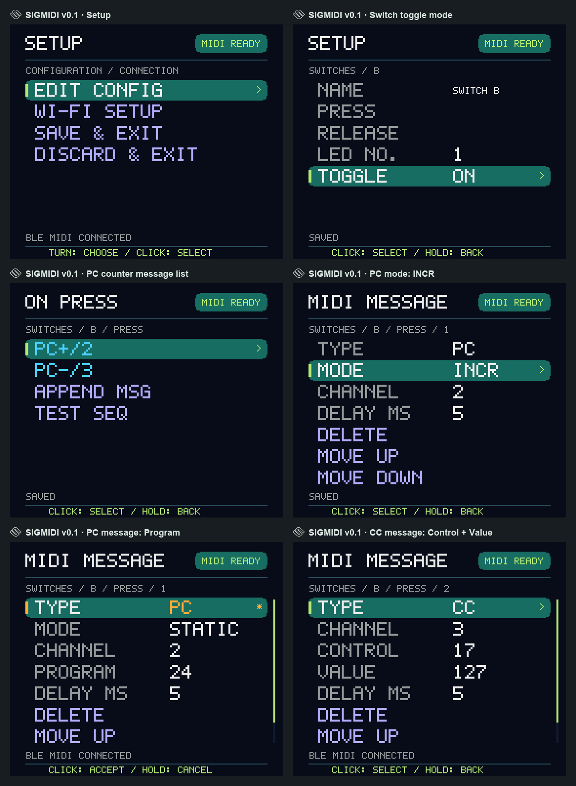
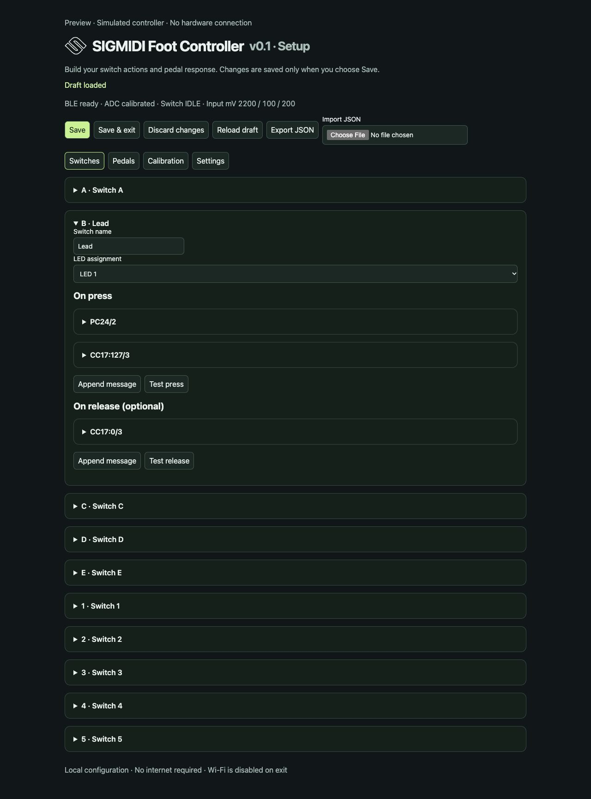

# SIGMIDI Foot Controller v0.1 — Previews

The illustrated [User manual](../output/pdf/sigmidi-foot-controller-0.1-user-manual.pdf) combines device and Wi-Fi screens with performance, editing and HX Stomp examples. Its [editable source](../docs/user-manual.md) is rebuilt with `scripts/build_user_manual.py` using ReportLab, Pillow and Arial fonts.

The illustrated [Assembly guide](../output/pdf/sigmidi-foot-controller-0.1-assembly-guide.pdf) covers the Main and Modular builds in both handednesses, with physical-order Nano pins, LCD/encoder wiring, the switch ladder, passive pedals and optional power/LEDs. [Editable source](../docs/assembly-guide.md); rebuild with `scripts/build_assembly_guide.py` using ReportLab, Pillow, pypdf and Arial fonts.

## Enclosure renderings

**Left is preferred**, with electronics on the left and extensions to the right. [Left main](sigmidi-left-main.png) · [Left modular](sigmidi-left-modular.png) · [Right main](sigmidi-right-main.png) · [Right modular](sigmidi-right-modular.png).

### Left

[Main top](../design/fusion/mirrored/main/top.png) · [Assembly](../design/fusion/mirrored/main/assembled.png) · [Rear](../design/fusion/mirrored/main/rear.png) · [Exploded](../design/fusion/mirrored/main/exploded.png) · [Display underside](../design/fusion/mirrored/main/display-underside.png) · [Base mounts](../design/fusion/mirrored/main/base-mounts.png) · [25 mm embossed icon](../design/fusion/mirrored/main/embossed-icon.png).

[Modular top](../design/fusion/mirrored/modular/top.png) · [Modular assembly](../design/fusion/mirrored/modular/assembled.png) · [Modular exploded](../design/fusion/mirrored/modular/exploded.png) · [Assembly guide](../design/fusion/mirrored/README.md).

### Right

[Top](../design/fusion/panel-top.png) · [Rear](../design/fusion/rear.png) · [Internal layout](../design/fusion/internal.png) · [Base supports](../design/fusion/base-supports.png) · [Labels](../design/fusion/switch-labels.png) · [Modular assembly](../design/fusion/modular/modular-assembled.png) · [Print orientations/supports](../design/fusion/print/printing-orientations-supports.png).

[Converter clips](../design/fusion/clip-mount.png) · [Base vents](../design/fusion/ventilation-base.png) · [Rear vents](../design/fusion/ventilation-rear.png) · [Vent membrane section](../design/fusion/rear-vent-membrane-section.png) · [Joint clearance sections](../design/fusion/snug-fit-sections.png).

[Current Nano mounting detail](../design/fusion/nano-esp32/installed.png) · [Nano exploded mount](../design/fusion/nano-esp32/exploded.png) · [Adapter assembly guide](../design/fusion/nano-esp32/README.md). The Nano sits component-side down on the retained base; the adapter detail shows its current fit.

Exterior renders come from native Fusion geometry; manifests record image hashes. Presentation sheets are generated with `scripts/brand_enclosure_previews.py`.

## Firmware LCD

[USB-only and USB+BLE performance states](usb-midi-preview.png) use the production renderer and current Nano firmware.

The production renderer and `tests/display_preview.cpp` menu harness generate the 280×240 native screens `01.png`–`26.png` and contact sheets. [All device screens](display-preview.png) include both enclosure variants and calibration menus. Run `python3 scripts/preview_display.py` with Pillow, a C++17 compiler and ESP-IDF cJSON sources.

[Switch toggle setting](toggle-menu-preview.png) · [PC counter menus: STATIC / INCR / DECR](pc-counter-menu-preview.png) · [Performance overview](display-overview.png) · [PC/CC forms](menu-editor-preview.png) · [LED settings](led-menu-preview.png) · [Enclosure selector](enclosure-menu-preview.png).

[Left/Right switch and calibration menus](enclosure-menus-both-variants.png) · [Scrolled continuation](enclosure-menus-scrolled.png). Left is the left column; Right is the right column. Captures use ten-switch defaults and are upright for the matching enclosure.

## Wi-Fi editor

[Toggle mode editor](wifi-toggle.png) · [PC+ / PC− counter editor](wifi-pc-counters.png) · [Static PC editor](wifi-pc-editor.png) · [CC editor](wifi-cc-editor.png) · [Settings](wifi-settings.png) · [Calibration](wifi-calibration.png).

[Both switch lists](wifi-switches-both-variants.png) · [Both calibration lists](wifi-calibration-both-variants.png). Left reads A–E / 1–5; Right reverses each row. Calibration fields display whole millivolts. Actions, calibration and LED assignments remain attached to physical taps.

Full pages: [Left switches](wifi-left-switches.png), [Right switches](wifi-right-switches.png), [Left calibration](wifi-left-calibration.png), [Right calibration](wifi-right-calibration.png). Screenshots use the production editor with simulated default configuration and example actions, without a hardware connection. `scripts/preview_wifi.py` serves the demo; `scripts/compose_wifi_variant_previews.py` assembles comparisons.

## Installer and branding

[Web flasher](web-flasher.png) shows the installer with verified firmware, a Left enclosure render and Supported hardware details. [Run instructions](../docs/web-flasher.md).

[Brand assets](../design/branding/README.md) share the supplied SIGMIDI outline across LCD, Wi-Fi editor, installer and presentation sheets. [Render metadata](sigmidi-enclosure-renders.json).

## Cable routing proposal

[Interactive Left layout](cable-bundles-left.html) · [Full layout](cable-bundles-left.png) · [Electronics detail](cable-bundles-left-detail.png) · [SVG](cable-bundles-left.svg). Select a purpose in the interactive view to isolate that harness. Colors distinguish 9 V input, regulated 5 V, ground, switch ladder, expression pedals, LCD, encoder and optional LEDs.

The Nano footprint and mounting holes come from the verified adapter-kit pose; other component footprints come from the Left main CAD assembly. Power/LED corridors use the model references; the analog/LED interface area and other routing are proposals. Lines show bundle corridors rather than shared electrical nets. Vertical clearance, carrier mounting and connector placement require review before building. The preview does not change Fusion geometry or firmware settings.

## Electrical diagram

[KiCad schematic preview](kicad-schematic.html) · [Native project and verification](../design/kicad/README.md). The vector preview is exported by KiCad from the editable schematic; use the zoom controls for pin details. Refresh it with `python3 scripts/preview_kicad.py` after exporting the current KiCad SVG, PNG, XML netlist and Konnect pin locations.

[Single-page browser preview](electrical-single-page.html) · [Single-page A0 PDF](../output/pdf/sigmidi-electrical-single-page.pdf) · [Seven-sheet browser preview](electrical-diagram.html) · [A3 PDF](../output/pdf/sigmidi-electrical-diagram.pdf) · [SVG sheets, BOM and terminal schedule](../design/electrical/README.md).

The unified schematic connects every fitted terminal with continuous wires, including Nano 3V3, 9V VIN, the separate 5V LED rail, common ground and the USB VBUS divider (100k/150k). Nano physical top view has USB-C up, JP1 pads 1–15 on the left and JP2 pads 15–1 on the right. Printed board labels remain visible, with GPIO names on connected pins. The LCD P2 connector retains physical pin order BL, RST, D/C, CS, CLK, DIN, GND, VCC. Both pedal ports share one J2 housing; the passive encoder uses internal GPIO pull-ups, and Pololu 2535 LEDs use direct D7/GPIO10 data. Board internals are omitted. The generator checks 46 component instances and 41 nets against the drawn wiring, including continuity and body-crossing checks. Rebuild with `scripts/preview_electrical.py`. Hardware verification remains required.

[Pedal startup / reconnection prompts](pedal-startup-preview.png) show both inputs pending and only pedal 2 still pending after pedal 1 sends. MOVE markers clear independently after accepted performance CC sends. Pending inputs show --- without a position bar; their numeric values appear only after the first accepted send.

[On-device editing screen paths](../docs/device-workflows/README.md) show the encoder actions and intermediate screens used to reach switch messages, pedal settings, calibration, LED settings and controller parameters. Regenerate with `scripts/build_device_workflows.py`; the routes are included on pages 8-9 of the user manual.
